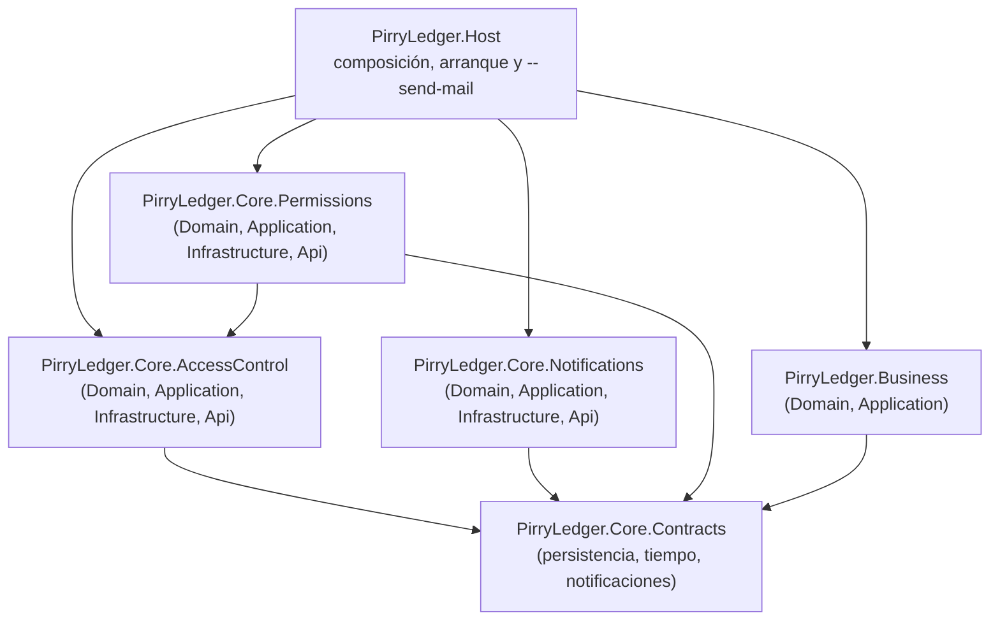
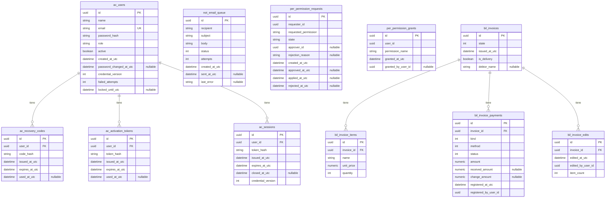

# Pirry Ledger

ERP para un negocio de comida rápida. Práctica 2 — Una suite que detecta defectos: Gestión de permisos.

En este punto el repositorio tiene la cola de email con su persistencia y un
comando para enviar lo pendiente. La API expone el registro con activación, el
inicio de sesión con su tabla de sesiones, la recuperación de contraseña y la
administración de usuarios. El módulo Permissions expone la gestión de
solicitudes de permiso con su máquina de estados y su suite de pruebas. El
módulo Business tiene la máquina de estados de `Invoice` con siete estados, sus
once transiciones permitidas y su suite de pruebas.

Este README está ordenado como se usa:

| # | Sección | Para qué |
|---|---|---|
| 1 | [Cómo correr el proyecto](#1-cómo-correr-el-proyecto) | De cero a la API levantada y verificada. |
| 2 | [Qué es y cómo está hecho](#2-qué-es-y-cómo-está-hecho) | Arquitectura, estructura y decisiones. |
| 3 | [Cómo probar cada criterio de aceptación](#3-cómo-probar-cada-criterio-de-aceptación) | Las pruebas, una por requisito. |
| 4 | [Referencia](#4-referencia) | Endpoints, base de datos y alcance. |

---

## 1. Cómo correr el proyecto

Todos los comandos están escritos para PowerShell en Windows. Sigue los pasos
en orden solo la primera vez; después, los pasos 5 a 8 son los que se repiten.

### Requisitos

- .NET SDK `10.0.400` (o una versión posterior de la misma banda, que
  `global.json` admite con `rollForward: latestFeature`). Aquí está instalada la
  `10.0.403` y `dotnet --version` la muestra.
- PostgreSQL 18, con una base `pirry_ledger` y un role que sea dueño de ella.
- Git.
- La herramienta global `dotnet-ef` `10.0.12`, solo para aplicar las
  migraciones.

Entity Framework Core en este proyecto necesita **dos piezas distintas**, que
no se reemplazan entre sí:

- **La herramienta global `dotnet-ef`** es el ejecutable `dotnet ef` que
  invoca el paso 5. Vive en tu perfil de usuario (`%USERPROFILE%\.dotnet\tools`)
  y se instala una sola vez por máquina. El repositorio fija su versión en
  `10.0.12` para que todas las copias del proyecto se comporten igual.
- **El paquete `Microsoft.EntityFrameworkCore.Design`** (`10.0.4` en este
  repositorio) lo referencian los proyectos de infraestructura para que
  `dotnet ef` pueda crear y ejecutar el `DbContext` de cada módulo. Lo baja
  `dotnet restore` desde los `.csproj`; **no se instala a mano** y la versión
  la Controla el repositorio, no la herramienta global.

Las versiones no coinciden a propósito: la herramienta global corre como
proceso aparte y el paquete se compila dentro de la aplicación. Mientras
`dotnet ef --version` responda `10.0.12`, el binario y el paquete son
compatibles aunque los números no sean iguales. Si quieres ver qué versión
del paquete está usando el proyecto, abre cualquiera de los dos
`.csproj` de infraestructura: `PirryLedger.Core.AccessControl.Infrastructure`
y `PirryLedger.Core.Notifications.Infrastructure`.

El Host además usa el paquete `DotNetEnv` para leer el archivo `.env` del paso
4. Tampoco hay que instalarlo a mano: `dotnet restore` (y el propio
`dotnet run`) lo baja desde `PirryLedger.Host.csproj`.

### Paso 1: instalar las herramientas

Instala .NET SDK `10.0.400` o superior, PostgreSQL 18 y Git. Después instala la herramienta
de Entity Framework una sola vez por usuario de Windows:

```powershell
dotnet tool install --global dotnet-ef --version 10.0.12
dotnet --version
dotnet ef --version
```

Debes obtener una versión `10.0.4xx` (aquí `10.0.403`) y Entity Framework `10.0.12`. Si `dotnet ef` ya
responde `10.0.12`, no vuelvas a ejecutar `dotnet tool install`; ejecuta solo
las comprobaciones de versión. Los paquetes `Design` y `DotNetEnv` ya están
declarados en los `.csproj` correspondientes; no ejecutes ningún otro
comando de instalación para ellos.

### Paso 2: clonar el repositorio

```powershell
git clone https://github.com/franklinpeguerodev/pirry-ledger.git
Set-Location pirry-ledger
git checkout develop
```

`develop` es la rama donde vive el trabajo: `main` queda detrás y solo se
actualiza cuando se integra. Para una entrega concreta, comprueba el tag
(`git tag`) y haz `git checkout practica-1` si es lo que pide la entrega.

### Paso 3: preparar PostgreSQL

Crea una base llamada `pirry_ledger` y un role que sea dueño de ella solo la
primera vez. PostgreSQL debe estar iniciado y accesible desde la máquina. No
guardes la contraseña en el repositorio: se usará mediante
`ConnectionStrings__PirryLedger`.

Conéctate primero con una cuenta que pueda crear rolees y bases de datos. En
`psql`, ejecuta:

```sql
CREATE roleE <usuario> WITH LOGIN PASSWORD '<contraseña>';
CREATE DATABASE pirry_ledger OWNER <usuario>;
```

Reemplaza `<usuario>` y `<contraseña>` por valores de tu entorno. Si el role o
la base ya existen, no ejecutes esas dos sentencias otra vez: produce un error
de objeto duplicado. En PostgreSQL, los nombres sin comillas se guardan en
minúsculas; por eso conviene usar un usuario como `pirry_ledger_app`.

Desde PowerShell puedes abrir `psql` así, si está disponible en el `PATH`:

```powershell
psql -U postgres -h 127.0.0.1 -d postgres
```

Cuando `psql` solicite la contraseña, escribe la del administrador de
PostgreSQL. Después de ejecutar el SQL, sal con `\q`.

### Paso 4: definir las variables de entorno

La aplicación lee todo de variables de entorno (RD-10). **Ninguna va en el
repositorio**: esta tabla es el nombre de cada una y para qué sirve; nunca
contiene valores reales.

| Variable | Para qué sirve |
|---|---|
| `ConnectionStrings__PirryLedger` | **Obligatoria.** Cadena de conexión a PostgreSQL: host, puerto, base de datos, usuario y contraseña. |
| `PIRRY_LEDGER_PUBLIC_BASE_URL` | **Obligatoria.** Dirección pública de la aplicación. Fija a la vez el host y el puerto donde escucha la API y la dirección con la que se construyen los enlaces de activación. |
| `PIRRY_LEDGER_SMTP_HOST` | Servidor SMTP saliente, por ejemplo `smtp.gmail.com`. |
| `PIRRY_LEDGER_SMTP_PORT` | Puerto SMTP. Con `StartTls` suele ser `587`. |
| `PIRRY_LEDGER_SMTP_SECURITY` | Cómo se cifra el transporte: `StartTls`, `Ssl` o `Ninguno`. |
| `PIRRY_LEDGER_SMTP_USER` | Cuenta con la que se autentica el envío. |
| `PIRRY_LEDGER_SMTP_PASSWORD` | Contraseña de aplicación de esa cuenta. Nunca la contraseña de la cuenta. |
| `PIRRY_LEDGER_SMTP_FROM` | Dirección de email que aparece como remitente. |
| `PIRRY_LEDGER_FIRST_ADMIN_EMAIL` | email del primer Administrador. Ver [El primer Administrador](#el-primer-administrador). |
| `PIRRY_LEDGER_FIRST_ADMIN_PASSWORD` | Contraseña del primer Administrador. Cumple la política de RF-CA-14. |
| `PIRRY_LEDGER_FIRST_ADMIN_NAME` | Nombre que se muestra. Si no se define, es `Administrator`. |

Las dos obligatorias se necesitan para arrancar la aplicación y para ejecutar el
enviador de email. Las seis SMTP son opcionales: sin ellas la aplicación y el
registro funcionan igual, pero el enviador no podrá entregar emails reales. Las
tres del primer Administrador también son opcionales; sin ellas no se crea
automáticamente ningún Administrador.

Al arrancar, la aplicación busca un archivo `.env` desde el directorio desde el
que lanzas el comando hacia arriba y carga sus variables. Ese archivo es la
**única** forma de definirlas que documenta este README. Si todavía no tienes
uno, créalo desde la plantilla (si ya existe, déjalo como está):

```powershell
if (-not (Test-Path .env)) { Copy-Item .env.example .env }
```

Edita `.env` y pon tus valores en las líneas que te interesen. Con eso basta:

- Vale para cualquier terminal y para cualquier comando: la API (paso 7), el DLL
  compilado y el enviador de email. No hay que repetir nada en cada sesión ni
  guardar nada en Windows.
- **Excepción: las migraciones (paso 6) no leen el `.env`.** `dotnet ef` no
  arranca la aplicación, sino la fábrica en tiempo de diseño de cada pieza, y esa
  fábrica lee la variable del entorno del proceso. El paso 6 explica cómo
  definirla en la terminal antes de migrar.
- Si no existe el `.env`, no es un error: la aplicación sigue buscando las
  variables en el entorno del sistema, y si tampoco están, avisa por el nombre
  de la que falta y se detiene (RD-08).
- `.env` está en el `.gitignore`: **nunca** se sube al repositorio. Sí se sube
  `.env.example`, la plantilla con las once variables, sus descripciones y
  valores de ejemplo. Nunca pongas un valor real en `.env.example`.
- Si un valor tiene espacios o el carácter `#`, ponlo entre comillas dobles.
- Si una variable ya está definida en el entorno del sistema (por ejemplo, un
  residuo de una versión anterior de este README), manda la del entorno y el
  `.env` no la pisa: bórrala de Windows para que mande el archivo. En un equipo
  limpio no hay ninguna definida.
- Las seis SMTP también viven en el `.env`: se completan en el paso
  [SMTP real con Gmail](#paso-opcional-smtp-real-con-gmail).

### Paso 5: compilar y ejecutar las pruebas

Antes de levantar la API, comprueba que el código compile y que las piezas se
puedan probar sin iniciar la aplicación. Puedes repetir estos comandos después
de cambios de código; no modifican la base de datos:

```powershell
dotnet build pirry-ledger.slnx --configuration Release
dotnet test pirry-ledger.slnx --configuration Release
```

Resultado esperado: `0 Errores`, `0 Advertencias` y todas las pruebas pasan.

### Paso 6: aplicar las migraciones

Ejecuta estos comandos **solo la primera vez que prepares esta base de datos**,
o después de incorporar una migración nueva. EF Core registra las migraciones
aplicadas, así que volver a ejecutar `database update` no duplica tablas, pero
no es necesario repetirlo en cada arranque.

**Antes, define la cadena de conexión en esta misma terminal.** A diferencia de
la aplicación, `dotnet ef` no carga el `.env`: usa la fábrica en tiempo de diseño
de cada pieza, que lee la variable del entorno del proceso. Sustituye los
valores de ejemplo por los tuyos, los mismos que están en tu `.env`:

```powershell
$env:ConnectionStrings__PirryLedger = 'Host=localhost;Port=5432;Database=pirry_ledger;Username=<usuario>;Password=<contrasena>'
```

Esa línea solo vive en la terminal abierta. En otra terminal hay que repetirla.

Las cuatro piezas, en este orden:

```powershell
dotnet ef database update --project Src/Core/PirryLedger.Core.AccessControl/PirryLedger.Core.AccessControl.Infrastructure
dotnet ef database update --project Src/Core/PirryLedger.Core.Notifications/PirryLedger.Core.Notifications.Infrastructure
dotnet ef database update --project Src/Core/PirryLedger.Core.Permissions/PirryLedger.Core.Permissions.Infrastructure
dotnet ef database update --project Src/Business/PirryLedger.Business/PirryLedger.Business.Infrastructure
```

Esto crea las tablas de AccessControl (`ac_users`, `ac_recovery_codes`,
`ac_activation_tokens` y `ac_sessions`), la cola de Notifications
(`not_email_queue`), las dos tablas de permisos (`per_permission_requests` y
`per_permission_grants`, con su índice único
`ux_per_permission_grants_user_permission`) y las cuatro tablas de facturas del
módulo Business (`bil_invoices`, `bil_invoice_items`, `bil_invoice_payments` y
`bil_invoice_edits`), en la misma base y manteniendo la propiedad de cada módulo.

El orden de los cuatro comandos da igual: ninguna de esas tablas declara claves
foráneas hacia otra pieza, así que ninguna depende de que la otra exista. Las
cuatro de `bil_` sí se referencian entre ellas, pero se crean en la misma
migración. Está comprobado también ejecutándolos en orden inverso.

Para comprobar que las cuatro se aplicaron:

```sql
SELECT table_name FROM information_schema.tables
WHERE table_schema = 'public'
ORDER BY table_name;
```

Son once tablas de módulo: las cuatro de `ac_`, `not_email_queue`, las dos de
`per_` y las cuatro de `bil_`. La tabla `__EFMigrationsHistory` que crea EF Core
es la duodécima fila, pero no es de ninguna pieza.

Resultado esperado:

```
Applying migration '20261018191406_InitialSchema'.
Done.
```

```
Applying migration '20261018213308_InitialSchema'.
Done.
```

```
Applying migration '20261021024258_InitialSchema'.
Done.
```

```
Applying migration '20261029150722_InitialBusinessSchema'.
Done.
```

Cuatro mensajes que no son errores. `Acquiring an exclusive lock...` sale en todas
las ejecuciones. Y en una base recién creada, EF Core va primero a preguntar por
su tabla de migraciones, que todavía no existe, así que imprime un
`Failed executing DbCommand` con el `SELECT ... FROM "__EFMigrationsHistory"`
justo antes de aplicar. Si la base ya está al día la respuesta es otra:

```
No migrations were applied. The database is already up to date.
Done.
```

> Si ese último mensaje aparece en una base **nueva**, no significa que esté al
> día: significa que esa pieza no tiene ninguna migración que EF pueda descubrir.
> Se comprueba con `dotnet ef migrations list --project <la pieza>`, que tiene
> que listar al menos una migración. Una migración sin su archivo
> `.Designer.cs` (el que lleva los atributos `[Migration]` y `[DbContext]`)
> existe en el repositorio pero EF la ignora en silencio.

### Paso 7: arrancar la API

```powershell
dotnet run --project Src/Host/PirryLedger.Host --launch-profile http
```

Mantén esta terminal abierta. El host y el puerto los fija
`PIRRY_LEDGER_PUBLIC_BASE_URL` (paso 4): es la misma variable que da la
dirección de los enlaces de activación, así que **una sola fuente** decide dónde
escucha la API y qué dirección llevan los enlaces. Con el valor del paso 4, la
API queda en `http://localhost:5243`. Se comprueba en la salida de la consola:

```
Now listening on: http://localhost:5243
Application started. Press Ctrl+C to shut down.
```

El perfil `--launch-profile http` solo fija el entorno de desarrolelo; el puerto
no sale de ahí. Por eso la API escucha en el mismo sitio aunque se lance el DLL
compilado directamente (`dotnet Src\Host\PirryLedger.Host\bin\Debug\net10.0\PirryLedger.Host.dll`)
o con otro perfil.

El proyecto del Host incluye un `appsettings.Development.json` local con la
configuración de logs para `ASPNETCORE_ENVIRONMENT=Development`. El archivo
**no se versiona**: lo ignora el `.gitignore` por diseño (mismo trato que
`appsettings.Staging.json` y los `appsettings.*.local.json`), para que nadie
termine subiendo al repositorio overrides de configuración pensados solo para
su máquina. Si necesitas uno, créalo a mano y mantenlo fuera del historial.

Si se va a abrir desde otra tablet o equipo, la variable debe ser la dirección
de esa máquina, no `localhost`, por ejemplo `http://192.168.1.10:5243`: la API
escucha en esa dirección y los enlaces del email salen con ella. Cambia el
valor en el paso 4 y vuelve a arrancar.

Si falta cualquiera de las dos variables obligatorias
(`ConnectionStrings__PirryLedger` o `PIRRY_LEDGER_PUBLIC_BASE_URL`), la
aplicación se detiene y avisa por consola el nombre exacto de la variable que
falta; no imprime ninguna traza (RD-08). Si el puerto ya está ocupado por otro
programa o el host de la variable no pertenece a esta máquina, la aplicación
también se detiene y el mensaje del sistema indica cuál de los dos es.

Al arrancar, la semilla crea el primer Administrador si las variables
`PIRRY_LEDGER_FIRST_ADMIN_*` están definidas y todavía no existe ningún
Administrador. Las lee del `.env`, así que funciona desde cualquier terminal.

Devuelve `404` en cualquier ruta que no exista, porque el resto del sistema
todavía no está construido. De las rutas de esta iteración, `/me` sin cabecera
`Authorization` responde `401` y no `404`: la ruta existe, lo que falta es la
credencial.

### Paso 8: comprobar que funciona

En una segunda terminal, registra un usuario Estándar:

```powershell
$cuenta = @{
    name = 'Ana'
    email = 'ana@ejemplo.com'
    password = 'abc12345'
} | ConvertTo-Json

Invoke-RestMethod `
    -Uri 'http://localhost:5243/api/auth/register' `
    -Method Post `
    -ContentType 'application/json' `
    -Body $cuenta
```

El registro responde `202` y la cuenta queda inactiva; el enlace de activación
se encola en la cola de email. Si ese email ya estaba registrado, la respuesta
es `409`: usa otro email y repite.

Para continuar necesitas el enlace de activación. Si configuraste [SMTP real con Gmail](#paso-opcional-smtp-real-con-gmail),
llega por email. Sin SMTP puedes leerlo directamente de la cola:

```sql
SELECT body FROM not_email_queue ORDER BY created_at_utc DESC LIMIT 1;
```

Abre el enlace recibido (`.../activate?token=<valor>`) y después prueba el login:

```powershell
$credenciales = @{
    email = 'ana@ejemplo.com'
    password = 'abc12345'
} | ConvertTo-Json

$sesion = Invoke-RestMethod `
    -Uri 'http://localhost:5243/api/auth/login' `
    -Method Post `
    -ContentType 'application/json' `
    -Body $credenciales

$sesion
```

Para comprobar que la sesión funciona (para que no dé `401`, la cuenta ya debe
estar activada):

```powershell
Invoke-RestMethod `
    -Uri 'http://localhost:5243/me' `
    -Headers @{ Authorization = "Bearer $($sesion.token)" }
```

Cuando esto responda, la instalación básica funciona: continúa con la sección
[3. Cómo probar cada criterio de aceptación](#3-cómo-probar-cada-criterio-de-aceptación).

### El primer Administrador

El registro público siempre crea un `Role.Standard`, porque un usuario recién
registrado no puede gobernarse a sí mismo. Por eso no hay forma de llegar a
Administrador por el camino normal, y sin uno **RF-CA-08, RF-CA-20 y RF-CA-21 no
se pueden probar**: los tres son operaciones que solo un Administrador puede
ejecutar.

La solución es una semilla que corre en el arranque y lee las tres variables
`PIRRY_LEDGER_FIRST_ADMIN_*`. La decisión y las alternativas están en
`docs/adr/002-first-administrator.md`.

Cómo se comporta:

- **Es idempotente.** Si ya existe algún Administrador, no hace nada y la
  aplicación arranca igual. Puedes arrancar la aplicación las veces que quieras.
- **El Administrador nace active.** No llega por email, así que no hay enlace
  de activación que abrir.
- **No promueve cuentas que ya existen.** Si el email de la semilla ya está
  registrado como Estándar, lo dice en consola y no toca la cuenta.
- **Respeta la política de contraseñas** (RF-CA-14): al menos 8 caracteres, con
  letras y números.
- **Si no defines las variables, no pasa nada.** La aplicación arranca sin
  Administrador y sin avisar.


La primera vez imprime:

```
Se creo el primer Administrator desde las variables de entorno.
```

La segunda vez no imprime nada, porque ya hay uno. Y con esa contraseña puedes
iniciar sesión y obtener un token (usa el email y la contraseña que definiste
en `PIRRY_LEDGER_FIRST_ADMIN_*`):

```powershell
$credenciales = @{ email = '<email-del-administrador>'; password = '<password-del-administrador>' } | ConvertTo-Json
Invoke-RestMethod -Uri 'http://localhost:5243/api/auth/login' -Method Post `
  -ContentType 'application/json' `
  -Body $credenciales
```


### Cómo enviar el email pendiente

El enviador es un proceso aparte (RF-NOT-09): no manda emails dentro de la
operación que los encola. Se lanza con un comando, no arranca solo:

```powershell
dotnet run --project Src/Host/PirryLedger.Host -- --send-mail
```

Funciona en cualquier terminal, con la API detenida o en marcha, da igual.

Imprime siempre un resumen y una línea final que depende del resultado. Sin
credenciales SMTP válidas, un email pendiente produce esto:

```
Correos tomados: 1
Correos enviados: 0
Correos fallidos: 1
  - ana@ejemplo.com: No se pudo entregar el email a ana@ejemplo.com por smtp.gmail.com:587. 534 5.7.9 Please log in with your web browser and then try again. ...
Los correos siguen en la cola como pendientes y se volveran a intentar la proxima vez.
```

Son cuatro ramas distintas y solo una se cumple a la vez. Los correos que fallan
vuelven a `Pending` con `attempts` incrementado: no se pierden. Sin email
pendiente la cuarta línea es `No habia correos pendientes de enviar.`; si hubo
envíos, es `Los correos enviados no se volveran a enviar aunque se ejecute el
comando otra vez.`

### Paso opcional: SMTP real con Gmail

Este paso solo es necesario si vas a probar el envío SMTP real. Gmail no debe
recibir la contraseña normal de tu cuenta: necesitas una **contraseña de
aplicación** creada en la configuración de seguridad de Google. Usa una cuenta
de prueba, si es posible. [Documentación de Google](https://support.google.com/mail/answer/185833?hl=es-419).

Las seis variables SMTP se definen, como todas las demás, **en el `.env`** y en
ningún otro sitio: no tocas Windows ni la terminal. La plantilla del paso 4 ya
las trae con valores de ejemplo, así que solo te queda lo tuyo:

| Variable | Qué poner |
|---|---|
| `PIRRY_LEDGER_SMTP_HOST` | Déjalo en `smtp.gmail.com`. |
| `PIRRY_LEDGER_SMTP_PORT` | Déjalo en `587`. |
| `PIRRY_LEDGER_SMTP_SECURITY` | Déjalo en `StartTls`. |
| `PIRRY_LEDGER_SMTP_USER` | Tu cuenta de prueba, dos veces (aquí y en `FROM`). |
| `PIRRY_LEDGER_SMTP_PASSWORD` | La contraseña de aplicación, **entre comillas dobles**, porque puede contener espacios. |
| `PIRRY_LEDGER_SMTP_FROM` | La misma cuenta de prueba: es la dirección que aparece como remitente. |

En el `.env` teórico, esas seis líneas se ven así:

```env
PIRRY_LEDGER_SMTP_HOST=smtp.gmail.com
PIRRY_LEDGER_SMTP_PORT=587
PIRRY_LEDGER_SMTP_SECURITY=StartTls
PIRRY_LEDGER_SMTP_USER=<tu-cuenta-de-prueba@gmail.com>
PIRRY_LEDGER_SMTP_PASSWORD="<password-de-aplicacion>"
PIRRY_LEDGER_SMTP_FROM=<tu-cuenta-de-prueba@gmail.com>
```

Si prefieres no escribir la contraseña a mano, este bloque la lee sin mostrarla
ni dejarla en el historial de la terminal y la escribe en `.env`, reemplazando
la línea si ya existe (no la duplica) o añadiéndola al final si falta:

```powershell
$segura = Read-Host -Prompt 'password de aplicacion SMTP' -AsSecureString
$credencial = New-Object System.Net.NetworkCredential('', $segura)
$plana = $credencial.Password -replace '\s', ''

$clave = 'PIRRY_LEDGER_SMTP_PASSWORD'
$linea = '{0}="{1}"' -f $clave, $plana
$ruta = Join-Path (Get-Location) '.env'
$lineas = [System.Collections.Generic.List[string]]::new()
[System.IO.File]::ReadAllLines($ruta) | ForEach-Object {
    if ($_ -match "^$clave=") { $lineas.Add($linea) } else { $lineas.Add($_) }
}
if ($lineas -notcontains $linea) { $lineas.Add($linea) }
[System.IO.File]::WriteAllLines($ruta, $lineas, (New-Object System.Text.UTF8Encoding($false)))

$segura = $null
$credencial = $null
$plana = $null
$lineas = $null
$linea = $null
```

Vuelve a arrancar la API después de editar el archivo: las variables se leen al
arrancar, no en cada petición.

Dos avisos:

- Si alguna de esas seis variables quedara definida como variable de entorno de
  Windows (versión antigua de este README), bórrala: el entorno manda sobre el
  `.env` y esa variable ignoraría el archivo.
- No escribas la contraseña de aplicación en el README, en el código, en
  comandos guardados ni en commits.

---

## 2. Qué es y cómo está hecho

### Qué es Pirry Ledger

Pirry Ledger es el ERP de un negocio de comida rápida con dos sucursales y 2–3
empleados por sucursal. Se usara a diario desde una tablet y contara con una vista personalizada para los dueños del negocio y es también el
proyecto de la asignatura Programación III.

La iteración actual (Práctica 1) entrega la primera pieza funcional del Core:
**Control de acceso completo**, desde el registro con activación por email
hasta la recuperación de contraseña y la administración de usuarios, más la
cola mínima de email saliente y la **estructura declarada** (sin pruebas) de la
máquina de estados del negocio.

### Arquitectura: monolito modular

Un solo despliegue, módulos con límites estrictos y dependencia en una sola
dirección (RD-03). La prueba mental: borrar `Src/Business` y el Core debe seguir
compilando.



Reglas que se ven en ese diagrama:

- **RD-01**: cada pieza expone sus propios endpoints; el Host no tiene
  controllers (`Program.cs` solo hace `app.MapAccessControl()`,
  `app.MapPermissions()` y `app.MapNotifications()`, que hoy no mapea ninguna
  ruta porque el envío de correo es un comando, no un endpoint).
- **RD-02**: la lógica de negocio vive en Domain y Application, nunca en los
  endpoints. En la capa Api solo se traduce HTTP a una llamada de caso de uso.
- **RD-03**: Business referencia únicamente `PirryLedger.Core.Contracts`; el
  Core no referencia Business en ningún `.csproj`.
- **Una dependencia cruzada entre dos piezas del Core**: `Permissions`
  referencia `AccessControl` (la capa Application, para el punto único de
  acceso, y la capa Api, para el filtro). La razón y el plan para
  deshacerla están en `docs/current-iteration.md`, decisión 5.
- **RD-12**: cada pieza tiene su proyecto de pruebas en `Tests/` y corre sin
  levantar la API.
- Un solo reloj inyectable `IClock` para todo el sistema (RD-11); ninguna clase
  llama a `DateTime.UtcNow` por su cuenta.

Cada módulo se capa igual: `Domain` (entidades y reglas), `Application` (casos
de uso), `Infrastructure` (PostgreSQL, migraciones, SMTP) y `Api` (endpoints).
`PirryLedger.Host` es composición y nada más: arranca la aplicación, registra
los módulos, lee la configuración obligatoria, fija la dirección de escucha con
`PIRRY_LEDGER_PUBLIC_BASE_URL` y sirve el comando `--send-mail`.

### Estructura del repositorio

```
pirry-ledger/
├── global.json                     Fija el SDK .NET 10.0.400 (rollForward: latestFeature)
├── pirry-ledger.slnx               Solución con todos los proyectos
├── .env.example                    Plantilla de variables de entorno (el .env real no se sube)
├── docs/
│   ├── current-iteration.md        Alcance de la iteración actual
│   ├── maquina-de-estados.md       Tabla de transiciones de Invoice (requerida por la práctica)
│   ├── assignments/                Briefs de las asignaciones (qué se entrega, rúbrica, cómo se entrega)
│   ├── adr/                        Decisiones técnicas 001 a 012: nombre y título en inglés, contenido en español
│   ├── bitacoras/                  Bitácoras de trabajo
│   └── requirements/               Requisitos originales
├── Src/
│   ├── Core/
│   │   ├── PirryLedger.Core.Contracts/          Persistencia, IClock, notificaciones, Auth (Operation, AccessLevel), Permissions (IPermissionAuthority, IPermissionRequestGateway)
│   │   ├── PirryLedger.Core.AccessControl/      Domain, Application, Infrastructure, Api
│   │   ├── PirryLedger.Core.Notifications/      Domain, Application, Infrastructure, Api
│   │   └── PirryLedger.Core.Permissions/       Domain, Application, Infrastructure, Api (Asignación 2)
│   ├── Business/
│   │   └── PirryLedger.Business/                Domain (Invoice, máquina de estados), Application, Infrastructure, Api
│   └── Host/
│       └── PirryLedger.Host/                    Composición + comando --send-mail
└── Tests/
    ├── PirryLedger.Business.Tests/              Proyecto de pruebas xUnit
    ├── PirryLedger.Core.AccessControl.Tests/    Proyecto de pruebas xUnit
    ├── PirryLedger.Core.Notifications.Tests/    Proyecto de pruebas xUnit
    ├── PirryLedger.Core.Permissions.Tests/      Proyecto de pruebas xUnit
    └── PirryLedger.Integration.Tests/           Integración real Business ↔ Permissions (sección 3.13)
```

Las pruebas usan dobles en memoria y un reloj falso: no necesitan base de datos
ni servidor SMTP. La suite de integración es la excepción deliberada: no
sustituye a Business ni a Permissions, solo ejecuta sus repositorios reales
sobre EF Core en memoria.

### Mapa de requisitos de esta iteración

| Flujo | Requisitos | Sección para probarlos |
|---|---|---|
| Registro y activación | RF-CA-01, 02, 14, 15, 16, 17 | [3.1](#31-registro-y-activación) |
| Sesión | RF-CA-03, 07, 18, 19 | [3.2](#32-sesión) |
| Contraseñas (recuperación, forzado, cambio) | RF-CA-09, 10, 11, 12, 13, 22 | [3.3](#33-contraseñas) |
| rolees y administración de usuarios | RF-CA-04, 05, 06, 08, 20, 21 | [3.4](#34-administración-de-usuarios) |
| Cola de email saliente | RF-NOT-08, 09, 12, 13 | [3.5](#35-cola-de-email) |
| Máquina de estados del negocio | RF-NEG-03, 04, 05, 09, RD-04 | [3.6](#36-máquina-de-estados-del-negocio) |
| **Gestión de permisos** | **RF-GP-01 … RF-GP-07**, RD-04, RD-07, RD-09, RD-12 | **[3.8](#38-gestión-de-permisos-rf-gp-01-a-rf-gp-07)** |
| **Operaciones del negocio (facturas)** | **RF-NEG-02, RF-NEG-06**, RF-GP-01, RD-01, RD-02, RD-06 | **[3.12](#312-operaciones-del-negocio-protegidas-por-acceso-rf-neg-02-rf-neg-06-rf-gp-01-rd-06)** |
| **Integración Business ↔ Permissions** | **RF-NEG-06**, RF-GP-05, RD-03, RD-12 | **[3.13](#313-integración-real-entre-business-y-permissions-rf-neg-06)** |
| Reglas de diseño transversales | RD-05 … RD-12 | [3.7](#37-trazabilidad-de-reglas-de-diseño) |

> **Asignación 2** — además de Práctica 1, esta iteración entrega la pieza
> `PirryLedger.Core.Permissions` (solicitudes de permiso, RF-GP-01 a RF-GP-07) con
> su suite de pruebas, su migración propia y su sección
> [3.8](#38-gestión-de-permisos-rf-gp-01-a-rf-gp-07), donde está cómo provocar
> cada criterio. La tabla de arriba y los enlaces a las secciones 3.x cubren
> ambas.

> **Práctica 3** — esta entrega añade el módulo Business completo (la máquina de
> estados, las reglas de la factura y sus operaciones por HTTP) y el consumo de
> una concesión de permiso al anular. Las secciones [3.6](#36-máquina-de-estados-del-negocio),
> [3.10](#310-reglas-de-la-factura-y-persistencia-rf-neg-02-rd-07-rd-09),
> [3.11](#311-consumo-de-una-concesión-de-permiso-rf-gp-05-rf-neg-06-adr-011) y
> [3.12](#312-operaciones-del-negocio-protegidas-por-acceso-rf-neg-02-rf-neg-06-rf-gp-01-rd-06)
> y [3.13](#313-integración-real-entre-business-y-permissions-rf-neg-06)
> son suyas.

### Decisiones documentadas

Convención de los ADR: nombre de archivo y título en inglés, contenido en español.

| Decisión | ADR |
|---|---|
| Credencial de sesión: token opaco, tabla `ac_sessions` y `CredencialVersion` | `docs/adr/001-session-credential.md` |
| Primer Administrador: semilla desde variables de entorno en el arranque | `docs/adr/002-first-administrator.md` |
| Trazabilidad del cambio de contraseña (`passwordCambiadaUtc`) sin auditoría completa | `docs/adr/003-password-change-traceability.md` |
| Columnas de AccessControl en snake_case, declaradas con `HasColumnName` | `docs/adr/004-snake-case-column-naming.md` |
| Dirección de escucha de la API desde `PIRRY_LEDGER_PUBLIC_BASE_URL`, la misma variable que arma los enlaces | `docs/adr/005-listen-address-from-public-base-url.md` |
| Variables de entorno de desarrolelo local desde un archivo `.env` cargado con `DotNetEnv` | `docs/adr/006-local-env-configuration.md` |
| Enviador de correo: comando CLI `--send-mail` en el Host, no servicio en segundo plano | `docs/adr/007-mail-sender-cli-command.md` |
| Concesiones de permisos viven en su propia tabla `per_permission_grants`, independiente de `per_permission_requests` | `docs/adr/008-permission-grants-table.md` |
| Cambiar el role invalida las sesiones abiertas vía `CredentialVersion`, igual que cambiar la contraseña o desactivar | `docs/adr/009-role-changes-invalidate-sessions.md` |
| El `role` de las respuestas viaja como texto, no como número | `docs/adr/010-role-as-text-in-responses.md` |
| La anulación consume la concesión `CancelInvoice:<id>` antes de guardar, y sin concesión se rechaza | `docs/adr/011-consume-permission-grant.md` |
| La operación de negocio pide el permiso por un contrato de `Core.Contracts`, y el `403`/`409` distingue "recién pedido" de "ya pendiente" | `docs/adr/012-request-permission-from-business.md` |

---

## 3. Cómo probar cada criterio de aceptación

Hay tres formas de probar: las pruebas automatizadas, la guía HTTP manual y las
consultas SQL que cada sección indica.

### Guía HTTP manual

`Src/Host/PirryLedger.Host/PirryLedger.Host.http` es una guía de regresión
manual que recorre los 14 endpoints de AccessControl con sus rechazos, en el
orden de las secciones 3.1 a 3.4 y con el bloqueo de RF-CA-19 al final. Se
ejecuta con el cliente HTTP de VS Code (extensión REST Client) o con el de
JetBrains.

Para usarla:

1. Levanta la API (paso 7).
2. Completa una sola vez el bloque `--- Entradas ---` del archivo. El usuario
   estándar ya viene fijado en `ana@ejemplo.com`; el email y la contraseña del
   Administrador se copian de tu `.env` (`PIRRY_LEDGER_FIRST_ADMIN_*`, paso 4).
   No los escribas en el archivo ni en ningún sitio compartido.
3. Envía las peticiones de arriba hacia abajo. Hay **tres pausas**: el token de
   activación y los dos códigos de recuperación no llegan en ninguna respuesta
   HTTP, porque existen solo dentro del email en cola (RF-NOT-08). La guía
   indica la consulta SQL con la que se leen.
4. La última sección bloquea la cuenta quince minutos; ejecútala al final.

La guía no cubre tres cosas, a propósito: las reglas que la API no puede
alcanzar (el último Administrador active) y las que dependen del reloj
(expiración de sesión de 8 h) están en las pruebas unitarias; el enviador de
emails se prueba con `-- --send-mail` (sección 3.5); y los hashes, los
contadores y los estados de la cola se comprueban con las consultas SQL de cada
sección.

### Guía HTTP de la Práctica 2

`Src/Host/PirryLedger.Host/PirryLedger.Practica2.http` es la guía completa de la
Práctica 2: 72 peticiones que recorren por HTTP las siete reglas de Gestión de
permisos (RF-GP-01 a 07), repiten los cuatro frentes de Control de acceso de la
revisión acumulada y dejan como comando lo que un archivo HTTP no puede
ejecutar (la suite y los seis defectos plantados).

Para usarla:

1. Levanta la API (paso 7).
2. Ejecuta una vez la SQL de reinicio del encabezado del archivo. Borra el
   usuario de prueba (`practica2@ejemplo.com`) y las filas de permisos del
   Administrador; no toca ninguna otra cuenta.
3. Completa el bloque `--- Entradas ---`: el usuario Estándar ya viene fijado y
   el correo y la contraseña del Administrador se copian de tu `.env`
   (`PIRRY_LEDGER_FIRST_ADMIN_*`, paso 4).
4. Envía las peticiones de arriba hacia abajo. Hay **dos pausas**, las dos del
   correo en cola: el token de activación y el código de recuperación. La guía
   indica la consulta SQL con la que se leen.
5. Al final, corre los comandos de las secciones §4 y §5 del archivo: la suite
   completa y cada etiqueta de defecto.

Cada petición dice en su título el código HTTP que debe devolver. El archivo
termina con las comprobaciones de contenido que no se ven en un código de
estado y con el checklist de la rúbrica.

### Pruebas

```powershell
dotnet test pirry-ledger.slnx
```

Un solo comando, desde un clon limpio, ejecuta **las cinco** suites y ninguna
necesita base de datos ni servidor SMTP: AccessControl (109), Notifications (6),
Permissions (48), Business (134) e Integración (4). Son **301 pruebas** en total.
Las cuatro primeras cubren la máquina de estados de la solicitud, los casos de
uso, los repositorios y la máquina de estados de `Invoice` con una prueba por
fila de sus tablas. La suite de integración (sección
[3.13](#313-integración-real-entre-business-y-permissions-rf-neg-06))
usa las piezas reales de Business y Permissions sobre EF Core en memoria y
demuestra las dos caras de la anulación. Todas usan un reloj falso (RD-12).

Termina con todas las pruebas superadas y ninguna con error. El envío SMTP real
y la lectura de sus credenciales desde variables de entorno se verifican
manualmente con `--send-mail`, más abajo.

### Defectos

La suite se mide por si falla cuando el código tiene un defecto. Los seis
defectos de la variante A (`docs/assignments/practica-2-defectos.md`) se plantan
uno por uno en un commit que cuelga de `practica-2`, se etiqueta
`practica-2-defecto-N` y no toca ningún archivo de pruebas. Con el defecto
plantado, el comando de arriba falla en la prueba que se indica; sobre
`practica-2` todas pasan.

| Defecto | Qué se planta | Prueba que lo detecta | Qué comprueba esa prueba |
|---|---|---|---|
| 1 (RF-GP-06) | `ApprovePermissionRequest.cs:62`: la guarda pasa de «lanza si el estado no es `Pending`» a «lanza solo si es `Rejected`», así que una solicitud ya aprobada o aplicada se vuelve a aprobar. | `AprobarUnaSolicitudYaAprobadaNoCambiaElEstado` | Que una segunda aprobación se rechace y el estado siga en `Applied`. |
| 2 (RF-GP-06) | `PermissionRequestStateMachine.cs:28`: añade `Rejected -> Applied` a la tabla. | `RejectedNoTieneSalidas` y `SoloLasTresTransicionesDeLaTablaSonValidas` | Que `Rejected` no tenga salidas y que solo las tres transiciones de la tabla sean válidas. |
| 3 (RF-GP-07) | `ApprovePermissionRequest.cs:71` y `RejectPermissionRequest.cs:62`: elimina la comparación de identidades. | `UnAdministradorNoPuedeAprobarSuPropiaSolicitud`, `UnEstandarAscendidoNoPuedeAprobarSuPropiaSolicitud` y `UnAdministradorNoPuedeRechazarSuPropiaSolicitud` | Que nadie resuelva una solicitud creada por él mismo, ni al aprobar ni al rechazar. |
| 4 (RF-GP-02) | `PermissionRequestRepository.cs:43`: el filtro pasa de «el solicitante es quien consulta» a «el solicitante no es quien consulta». | `ListarPorSolicitanteDevuelveSoloLasSolicitudesDeEseSolicitante` | Que la consulta devuelva solo las solicitudes del usuario que consulta. |
| 5 (RF-GP-06) | `PermissionRequestStateMachine.cs:28`: añade `Approved -> Pending` a la tabla. | `SoloLasTresTransicionesDeLaTablaSonValidas` | Que una solicitud aprobada no vuelva a `Pending`: solo las tres transiciones de la tabla son válidas. |
| 6 (RF-GP-04) | `PermissionRequest.cs:99`: elimina `RejectionReason = reason;`. | `RechazarUnaSolicitudPendienteLaPasaARechazadaConMotivo` | Que la solicitud rechazada guarde el motivo escrito. |

Para ver un defecto: `git checkout practica-2-defecto-N`, correr
`dotnet test pirry-ledger.slnx` y comprobar que falla al menos una de las pruebas
de su fila. `git diff practica-2 practica-2-defecto-N --stat` muestra que el
commit solo toca código de Gestión de permisos y ningún archivo de pruebas.

### Preparación común

Casi todas las pruebas manuales necesitan lo mismo:

1. La API levantada (paso 7) y una cuenta **activada** (paso 8).
2. Para las operaciones administrativas, el token del Administrador de la
   semilla (sección [El primer Administrador](#el-primer-administrador)).

Cuando una prueba pide `<token-del-administrador>` o `<token-del-estandar>`,
obtenlo del login:

```powershell
$sesion = Invoke-RestMethod -Uri 'http://localhost:5243/api/auth/login' -Method Post `
  -ContentType 'application/json' -Body (@{ email = '<email>'; password = '<password>' } | ConvertTo-Json)

$adminHeaders = @{ Authorization = "Bearer $($sesion.token)" }
```

### 3.1 Registro y activación

#### RF-CA-01 — el registro acepta un email libre y rechaza el duplicado

Registra un email cualquiera. Después repite con el mismo email, también en
mayúsculas, y comprueba que la segunda vez responde `409` con el mismo mensaje
que un email nuevo.

```sql
SELECT email, active FROM ac_users ORDER BY email;
```

Hay una sola fila por email, sin importar si se escribió en mayúsculas o con
espacios alrededor.

#### RF-CA-02 — la contraseña no se guarda en claro

```sql
SELECT email, left(password_hash, 40) AS inicio FROM ac_users;
```

El hash empieza por `$argon2id$v=19$m=...` y **no** contiene la contraseña. Cada
fila tiene un hash distinto aunque dos usuarios usen la misma contraseña, porque
el salt es por usuario.

La fecha del último cambio de contraseña se conserva en
`password_changed_at_utc`. Es `NULL` para una cuenta que todavía usa la
contraseña inicial y se actualiza en UTC al cambiarla por recuperación, cambio
autenticado o restablecimiento forzado. Este campo ofrece trazabilidad mínima
sin guardar la contraseña ni sustituir la auditoría completa, que queda fuera
del alcance de esta práctica. La decisión y sus alternativas están en
`docs/adr/003-password-change-traceability.md`.

#### RF-CA-14 — la contraseña tiene al menos 8 caracteres, con letras y números

```powershell
# Menos de 8 caracteres -> 400
Invoke-RestMethod -Uri http://localhost:5243/api/auth/register -Method Post -Body (@{ nombre='A'; email='a@ejemplo.com'; password='abc12' } | ConvertTo-Json) -ContentType 'application/json'
# Solo letras -> 400
Invoke-RestMethod -Uri http://localhost:5243/api/auth/register -Method Post -Body (@{ nombre='A'; email='b@ejemplo.com'; password='abcdefgh' } | ConvertTo-Json) -ContentType 'application/json'
```


#### RF-CA-15 — la cuenta nace inactiva y el enlace es de un solo uso

Tras registrar, antes de abrir el enlace:

```sql
SELECT active FROM ac_users;   -- false
SELECT body FROM not_email_queue ORDER BY created_at_utc DESC LIMIT 1;
```

El email trae `<PIRRY_LEDGER_PUBLIC_BASE_URL>/activate?token=<64 caracteres
hexadecimales>`. En la tabla de tokens solo está el SHA-256:

```sql
SELECT left(token_hash, 20) FROM ac_activation_tokens;   -- SHA-256, no el token
```

Y con la cuenta todavía inactiva, el inicio de sesión se rechaza diciendo
exactamente que lo está:

```powershell
$credenciales = @{ email = 'ana@ejemplo.com'; password = 'abc12345' } | ConvertTo-Json
Invoke-WebRequest -Uri http://localhost:5243/api/auth/login -Method Post -Body $credenciales -ContentType 'application/json'
```

Resultado esperado: `401` con `{"message":"La cuenta no esta activada."}`.

Este mensaje **sí** es distinto del de credenciales incorrectas, y solo se
alcanza con la contraseña correcta. Es lo que exige RF-CA-15. Con la contraseña
equivocada la respuesta es la genérica, aunque la cuenta siga inactiva: así el
mensaje no sirve para averiguar qué emails están registrados, porque hace
falta conocer la contraseña para llegar a él.

#### RF-CA-16 — el enlace activa la cuenta y no se reutiliza

Abre el enlace del email: responde `200 {"activated":true}` y la cuenta queda
`active = true`. Ábrelo otra vez y responde `400`.

```sql
SELECT used_at_utc FROM ac_activation_tokens;   -- con fecha tras el primer uso
```

Un token inexistente, uno ya usado y uno recortado devuelven el mismo `400`, para
no revelar si ese enlace existió.

El token de activación vence 24 horas después de su creación. Para comprobarlo
sin esperar, modifica solo `expires_at_utc` del token de prueba a una hora anterior
a `now()` y repite la petición: debe responder `400` y la cuenta debe seguir
inactiva.

```sql
UPDATE ac_activation_tokens SET expires_at_utc = now() - interval '1 hour'
WHERE used_at_utc IS NULL;
```

#### RF-CA-17 — el reenvío es idéntico exista o no el email

Compara estas cuatro peticiones: la respuesta debe ser el mismo `202` con el
mismo body `{"sent":true}` en los cuatro casos.

```powershell
$resendActivation = 'http://localhost:5243/api/auth/resend-activation'
Invoke-WebRequest $resendActivation -Method Post -Body (@{email='ana@ejemplo.com'}|ConvertTo-Json) -ContentType 'application/json'    # pendiente de activar
Invoke-WebRequest $resendActivation -Method Post -Body (@{email='nadie@ejemplo.com'}|ConvertTo-Json) -ContentType 'application/json' # ese email no existe
Invoke-WebRequest $resendActivation -Method Post -Body (@{email='esto-no-es-email'}|ConvertTo-Json) -ContentType 'application/json' # mal formado
Invoke-WebRequest $resendActivation -Method Post -Body (@{email='ana@ejemplo.com'}|ConvertTo-Json) -ContentType 'application/json'    # ya activa
```

Son cuatro y no cinco porque son cuatro las salidas del caso de uso: el email
mal formado, el email que no existe, la cuenta ya activa y la cuenta pendiente.
Solo la cuarta genera algo. "Cuenta activa con un token vivo" no es un quinto
caso: activar la cuenta es justamente lo que deja el token sin usar, así que una
cuenta activa nunca tiene un token vivo que reenviar. La cuarta petición se
ejecuta **después** de activar con RF-CA-16.

Que el enlace nuevo sirva y el viejo no:

```sql
SELECT u.email, count(t.id) AS tokens_vivos
FROM ac_users u
LEFT JOIN ac_activation_tokens t
  ON t.user_id = u.id AND t.used_at_utc IS NULL
GROUP BY u.email;
```

`tokens_vivos` cuenta solo los tokens sin usar. El usuario pendiente de activar
tiene **uno solo**: al reenviar se invalidó el anterior, y los tokens ya
gastados siguen en la tabla con su `used_at_utc` puesto.

### 3.2 Sesión

#### RF-CA-03 — iniciar sesión devuelve un token y no revela qué cuentas existen

Necesitas una cuenta **activada**. Si aún no tienes una, registra
`ana@ejemplo.com` con la contraseña `abc12345` y abre el enlace como explica
RF-CA-16.

Con la aplicación en marcha, en otra terminal:

```powershell
$credenciales = @{ email = 'ana@ejemplo.com'; password = 'abc12345' } | ConvertTo-Json
Invoke-RestMethod -Uri http://localhost:5243/api/auth/login -Method Post -Body $credenciales -ContentType 'application/json'
```

Resultado esperado: un token de 43 caracteres, sin `+`, `/` ni `=` (32 bytes del
generador del sistema en base64url).

Ahora bien, un email que no existe y una contraseña equivocada tienen que ser
indistinguibles:

```powershell
Invoke-RestMethod -Uri http://localhost:5243/api/auth/login -Method Post `
  -Body (@{ email = 'nadie@ejemplo.com'; password = 'abc12345' } | ConvertTo-Json) `
  -ContentType 'application/json'
```

Resultado esperado: `401` con el mismo mensaje que el intento con contraseña
equivocada. Si los mensajes o el tiempo de respuesta fueran distintos, el
endpoint serviría para enumerar las cuentas que existen. Por eso el caso de uso
verifica la contraseña contra un hash señuelo cuando el email no existe: los dos
caminos ejecutan la misma operación de Argon2.

#### RF-CA-07 — el usuario autenticado conoce su nombre, email y role

```powershell
$sesion = Invoke-RestMethod -Uri http://localhost:5243/api/auth/login -Method Post -Body $credenciales -ContentType 'application/json'
Invoke-RestMethod -Uri http://localhost:5243/me -Headers @{ Authorization = "Bearer $($sesion.token)" }
```

Resultado esperado: `name`, `email` y `role`. Nunca el hash de la contraseña,
ni el token, ni `credencialVersion`.

Y sin cabecera:

```powershell
Invoke-RestMethod -Uri http://localhost:5243/me
```

Resultado esperado: `401` con `Sesion no valida.`

#### RF-CA-18 — cerrar sesión invalida esa credencial

```powershell
Invoke-RestMethod -Uri http://localhost:5243/api/auth/logout -Method Post -Headers @{ Authorization = "Bearer $($sesion.token)" }
Invoke-RestMethod -Uri http://localhost:5243/me -Headers @{ Authorization = "Bearer $($sesion.token)" }
```

El `logout` responde `204` y la segunda llamada responde `401`. Cerrar una
sesión no cierra las demás del mismo usuario: un empleado puede tener el móvil y
el portátil abiertos a la vez.

#### RF-CA-19 — cinco attempts fallidos bloquean la cuenta quince minutos

```powershell
1..5 | ForEach-Object {
  Invoke-RestMethod -Uri http://localhost:5243/api/auth/login -Method Post `
    -Body (@{ email = 'ana@ejemplo.com'; password = 'malaclave1' } | ConvertTo-Json) `
    -ContentType 'application/json'
}
```

Ahora la contraseña correcta se sigue rechazando:

```powershell
Invoke-RestMethod -Uri http://localhost:5243/api/auth/login -Method Post -Body $credenciales -ContentType 'application/json'
```

Resultado esperado: `401` con **el mismo mensaje** que los attempts fallidos
(`Email o contrasena incorrectos.`). Un mensaje propio confirmaría que ese
email existe. Pasados quince minutos el bloqueo se levanta solo y entra con la
contraseña correcta. Ese inicio correcto reinicia el contador:

```sql
SELECT failed_attempts, locked_until_utc
FROM ac_users
WHERE email = 'ana@ejemplo.com';
```

Resultado esperado después del login correcto: `failed_attempts = 0` y
`locked_until_utc` sin valor.

La expiración de las ocho horas de la sesión no se prueba esperando: `IClock` es
inyectable y las pruebas automatizadas avanzan el reloj.

### 3.3 Contraseñas

#### RF-CA-09 — solicitar recuperación sin revelar si el email existe

Solicita la recuperación con un email existente y con uno inexistente. Ambas
peticiones responden `202` con el mismo body; solo el email existente deja un
mensaje pendiente en `not_email_queue`.

```powershell
$recuperacion = @{ email = 'ana@ejemplo.com' } | ConvertTo-Json
Invoke-RestMethod -Uri http://localhost:5243/api/auth/recovery `
  -Method Post -Body $recuperacion -ContentType 'application/json'
```

Ejecuta el enviador (`--send-mail`) y usa el código recibido en:

```powershell
$restablecer = @{ codigo = '<codigo recibido>'; password = 'nueva12345' } | ConvertTo-Json
Invoke-RestMethod -Uri http://localhost:5243/api/auth/reset-password `
  -Method Post -Body $restablecer -ContentType 'application/json'
```

#### RF-CA-10 — el código es de un solo uso y vence

Ejecuta el enviador, usa el código recibido una vez y repite exactamente la
misma petición. La primera llamada cambia la contraseña; la segunda responde
`400` y no la cambia. El código se almacena como SHA-256 y vence en 15 minutos.

#### RF-CA-11 — una recuperación reemplaza la contraseña anterior

Después de un restablecimiento exitoso, inicia sesión con la contraseña anterior
y con la nueva. La anterior responde `401`; la nueva devuelve un token válido.

#### RF-CA-12 — cambiar la contraseña invalida sesiones existentes

Con una sesión abierta, completa un restablecimiento o un cambio autenticado y
repite una llamada protegida usando el token anterior. Debe responder `401`.
La fecha `password_changed_at_utc` queda registrada en UTC, pero no se crea un
historial de auditoría completo.

#### RF-CA-13 — restablecimiento forzado

Con el token de Administrador y el `id` del usuario:

```powershell
Invoke-RestMethod `
  -Uri 'http://localhost:5243/api/admin/users/<id>/force-reset' `
  -Method Post -Headers $adminHeaders
```

La contraseña anterior deja de funcionar inmediatamente y el nuevo código se
encola. El usuario completa el cambio mediante
`/api/auth/reset-password`.

#### RF-CA-22 — cambio autenticado

```powershell
$cambio = @{ passwordActual = 'abc12345'; nuevapassword = 'nueva12345' } | ConvertTo-Json
Invoke-RestMethod -Uri http://localhost:5243/api/auth/change-password `
  -Method Post -Headers @{ Authorization = "Bearer $($sesion.token)" } `
  -Body $cambio -ContentType 'application/json'
```

Una contraseña actual incorrecta produce un rechazo Controlado. El cambio aplica
la misma política mínima de RF-CA-14 e invalida las sesiones previas.

### 3.4 Administración de usuarios

La semilla del primer Administrador descrita arriba permite probar las cinco
rutas administrativas. Obtén el token del Administrador y sigue.

#### RF-CA-21 y RF-CA-05 — listar usuarios y proteger operaciones administrativas

```powershell
$adminHeaders = @{ Authorization = "Bearer <token-del-administrador>" }
Invoke-RestMethod -Uri 'http://localhost:5243/api/admin/users' `
  -Headers $adminHeaders
```

El resultado contiene únicamente `id`, `name`, `email`, `role`, `active` y
`createdAtUtc`. El `role` viaja como texto (`"Administrator"` o `"Standard"`),
no como número (ADR 010). Nunca contiene hashes, tokens ni `credentialVersion`.

Sin `Authorization`, las rutas administrativas responden `401`. La exigencia de
acceso se declara en un único punto en `RoleRequirements.cs`; cada ruta usa
`ConAcceso(...)` y el servidor rechaza una ruta de negocio que no declare su
operación.

#### RF-CA-04 — todo usuario tiene exactamente un role

Registra un usuario nuevo y revisa el resultado del listado administrativo:

```sql
SELECT email, role FROM ac_users ORDER BY created_at_utc DESC LIMIT 1;
```

El registro público siempre crea el role `Standard`; no acepta un role enviado por
el cliente. El único cambio posterior es la operación administrativa de
RF-CA-08.

#### RF-CA-06 — un usuario Estándar no puede ejecutar operaciones de Administrador

Obtén el token de un usuario Estándar e invoca manualmente una ruta
administrativa, sin depender de ninguna interfaz:

```powershell
Invoke-WebRequest `
  -Uri 'http://localhost:5243/api/admin/users' `
  -Headers @{ Authorization = 'Bearer <token-del-estandar>' }
```

Resultado esperado: `403`. La autorización se comprueba en el servidor, aunque
la petición se construya directamente con PowerShell.

#### RF-CA-08 — cambiar el role

Usa el `id` de otro usuario obtenido del listado:

```powershell
Invoke-RestMethod `
  -Uri 'http://localhost:5243/api/admin/users/<id>/role' `
  -Method Post -Headers $adminHeaders -ContentType 'application/json' `
  -Body '{"role":"Administrador"}'
```

Un Administrador no puede cambiarse su propio role. Un role inexistente produce
`400`. Un usuario Estándar recibe `403`, incluso si construye la petición
manualmente.

El cambio invalida la sesión del usuario afectado (`CredentialVersion` se
incrementa): tras un cambio de role, el usuario debe volver a iniciar sesión
para que su siguiente petición refleje el nuevo role. Lo mismo ocurre al
cambiar la contraseña (RF-CA-12) o al desactivar la cuenta (RF-CA-20). Ver
`docs/adr/009-role-changes-invalidate-sessions.md`.

#### RF-CA-20 — desactivar y reactivar

```powershell
Invoke-RestMethod `
  -Uri 'http://localhost:5243/api/admin/users/<id>/deactivate' `
  -Method Post -Headers $adminHeaders

Invoke-RestMethod `
  -Uri 'http://localhost:5243/api/admin/users/<id>/reactivate' `
  -Method Post -Headers $adminHeaders
```

Desactivar invalida las sesiones abiertas del usuario objetivo. Un Administrador
no puede desactivarse ni desactivar al último Administrador active. Repetir una
operación de status produce `400`, no un `500`.

### 3.5 Cola de email

#### RF-NOT-08 — la operación no necesita servidor de email

Deja el email sin configurar y comprueba que encolar funciona igual. Una fila
nace en `Pending` sin que ninguna operación abra una conexión SMTP.

```sql
SELECT status, attempts FROM not_email_queue ORDER BY created_at_utc DESC;
```

`status = 0` es `Pending` y `attempts = 0`.

#### RF-NOT-09 — el envío ocurre en un proceso aparte

Inserta un email pendiente con cualquier cliente SQL y ejecuta el enviador. El
paso a `Enviado` ocurre solo cuando el comando corre, nunca al encolar.

```sql
INSERT INTO not_email_queue (id, recipient, subject, body, status, attempts, created_at_utc)
VALUES (gen_random_uuid(), '<recipient>', 'Prueba', 'body de prueba', 0, 0, now());
```

Después del envío, `status = 2` y `sent_at_utc` tiene valor.

#### RF-NOT-12 — no se reenvía un email ya enviado

Ejecuta el enviador dos veces seguidas con un email pendiente:

```powershell
dotnet run --project Src/Host/PirryLedger.Host -- --send-mail
dotnet run --project Src/Host/PirryLedger.Host -- --send-mail
```

La primera ejecución envía; la segunda responde, con las cuatro líneas que el
comando imprime siempre:

```
Correos tomados: 0
Correos enviados: 0
Correos fallidos: 0
No habia correos pendientes de enviar.
```

Y el email sigue con `attempts = 1`: no se reclamó dos veces. Con dos emisores
corriendo a la vez sobre tres emails pendientes, uno toma los tres y el otro
toma cero.

#### RF-NOT-13 — las credenciales vienen de variables de entorno

Deja un email pendiente (el registro de un usuario deja pendiente su email de
activación) y quita la contraseña SMTP de la configuración: borra o vacía la
línea `PIRRY_LEDGER_SMTP_PASSWORD` de tu `.env`. Si en algún momento la
definiste además como variable de entorno de Windows, bórrala también de ahí:
el entorno manda sobre el `.env` y el archivo se quedaría sin efecto.

```powershell
dotnet run --project Src/Host/PirryLedger.Host -- --send-mail
```

Con la contraseña sin definir, `SmtpConfiguration.EstaConfigurada` es `false` y
el transporte se niega a enviar. El email sigue en la cola como pendiente y el
proceso informa:

```
Correos tomados: 1
Correos enviados: 0
Correos fallidos: 1
  - <recipient>: Faltan las variables de entorno del servidor de Email (RF-NOT-13). Revisa el README.
Los correos siguen en la cola como pendientes y se volveran a intentar la proxima vez.
```

Ningún mensaje de error imprime el usuario ni la contraseña: se sustituyen por
`[User SMTP]` y `[contrasena SMTP]` antes de mostrarse o guardarse.

### 3.6 Máquina de estados del negocio

La máquina de la factura tiene siete estados, once transiciones permitidas y
treinta y ocho prohibidas, y cada fila de esas tablas tiene su prueba. Se
verifica sin base de datos y sin levantar la aplicación (RF-NEG-03, RF-NEG-04,
RF-NEG-05, RF-NEG-09, RD-04, RD-12).

Documentación: `docs/maquina-de-estados.md`. Código: `InvoiceStateMachine.cs`,
`InvoiceTransitionContext.cs` con `Invoice.cs` e `InvoiceState.cs` en
`Src/Business/PirryLedger.Business/PirryLedger.Business.Domain/`. Pruebas:
`Tests/PirryLedger.Business.Tests/MaquinaDeEstados/`.

Verifica en ese orden:

1. **La entidad central tiene sus siete estados declarados en un solo lugar**
   (RF-NEG-03): `InvoiceState` declara `Draft`, `Issued`, `PendingVerification`,
   `Paid`, `InDebt`, `Cancelled` y `NotDelivered`.
2. **Las transiciones permitidas están declaradas en un solo sitio**
   (RF-NEG-04, RD-04): `InvoiceStateMachine` tiene una única lista
   `AllowedTransitions` con las once filas de la tabla de
   `docs/maquina-de-estados.md`. Ningún otro punto del código cambia el estado.
3. **Hay transiciones explícitamente prohibidas y dos estados terminales**
   (RF-NEG-05): los otros treinta y ocho pares lanzan
   `InvalidInvoiceTransitionException` sin cambiar el estado, y `Cancelled` y
   `NotDelivered` no tienen ninguna salida.
4. **Las condiciones de las filas se comprueban de verdad**: emitir sin ítems,
   cobrar sin cubrir el total, cobrar con transferencia, dejar una deuda sin
   nombre o marcar como no entregada una factura que no es de delivery se
   rechazan con `InvoiceConditionNotMetException` y el estado no cambia.

```powershell
dotnet test Tests\PirryLedger.Business.Tests\PirryLedger.Business.Tests.csproj
```

Salida esperada: **134 pruebas superadas**, 0 con error: las 62 de la máquina de
esta sección y las 72 de las reglas, la persistencia y los casos de uso de las
secciones 3.10 y 3.12. Los nombres dicen qué prueba cada una: `EmitirUnaFacturaConItemsEsValido`,
`UnaTransicionProhibidaSeRechazaYNoCambiaElEstado(desde: Issued, hacia: Draft)`,
`AnuladaNoTieneSalidas`, `NoEntregadaNoTieneSalidas`,
`EmitirSinItemsSeRechazaYNoCambiaElEstado`, entre otras.

Para ver que la suite puede fallar, quita la línea
`EnsureHasAtLeastOneItem(from, to, context);` del caso
`(InvoiceState.Draft, InvoiceState.Issued)` de `InvoiceStateMachine` y vuelve a
ejecutar el comando: `EmitirSinItemsSeRechazaYNoCambiaElEstado` se pone roja.
Restaura la línea y vuelve a verde. Esa línea es la que elimina el defecto 3.

No hay endpoint HTTP para la máquina de estados: es una pieza interna del
módulo Business. Los endpoints que la exponen están en la sección 3.12 y no
deciden transiciones: llaman al agregado, que delega en la máquina.

### 3.7 Trazabilidad de reglas de diseño

| Regla | Evidencia verificable |
|---|---|
| RD-04 | Toda transición de `Invoice` pasa por `InvoiceStateMachine`; la lista única `AllowedTransitions` es la única que decide (sección 3.6). |
| RD-05 | Las contraseñas se almacenan con hash y sal; las consultas SQL de RF-CA-02 muestran hashes, nunca contraseñas. |
| RD-06 | Las rutas administrativas rechazan con `403` a un usuario Estándar aunque invoque la API manualmente (RF-CA-06). |
| RD-07 | Toda entrada externa se valida antes de usarse: emails mal formados, contraseñas débiles y estados inválidos producen respuestas Controladas (RF-CA-14, RF-CA-20); un cuerpo JSON ilegible responde `400` y un `Content-Type` no admitido responde `415`, ambos con mensaje controlado (sección 3.9). |
| RD-08 | Las respuestas de error no exponen trazas, rutas locales, consultas SQL ni la cabecera `Authorization` de la petición, ni en desarrollo ni en producción (sección 3.9). |
| RD-09 | Usuarios y estados viven en PostgreSQL y sobreviven al reinicio de la aplicación. |
| RD-10 | La conexión, el primer Administrador y SMTP se configuran mediante variables de entorno (sección 1, paso 4). |
| RD-11 | Las fechas de dominio, tokens, sesiones y cambios de contraseña se registran en UTC mediante `IClock`. |
| RD-12 | AccessControl, Notifications, Permissions y Business tienen suites unitarias que corren sin levantar la API completa (`dotnet test`). |

### 3.8 Gestión de permisos (RF-GP-01 a RF-GP-07)

Todo lo de esta sección se ejecutó contra la API levantada siguiendo los pasos 1
a 7, y las salidas son reales. La colección de peticiones está en
`Src/Host/PirryLedger.Host/PirryLedger.Permissions.http`: son las mismas, en
orden, para quien prefiera el cliente HTTP de VS Code o el de JetBrains.

Antes de empezar necesitas un usuario **activado** (paso 8) y el token del
Administrador (sección [El primer Administrador](#el-primer-administrador)).

#### RF-GP-01 — un Estándar crea una solicitud y nace en Pendiente

```powershell
$solicitud = Invoke-RestMethod -Uri 'http://localhost:5243/api/permissions/requests' -Method Post `
  -Headers $estHeaders -ContentType 'application/json' `
  -Body (@{ requestedPermission = 'ViewSalesSummary' } | ConvertTo-Json)
```

```
202  {"id":"4b08f67b-60f3-440b-8e15-ad789927bea2"}
```

La solicitud nace en `Pending`. Un permiso que no está en el catálogo se
rechaza con `400` y un mensaje en español, sin crear nada:

```
400  {"message":"El permiso solicitado no existe."}
```

Sin cabecera `Authorization` responde `401` y `{"message":"Sesion no valida."}`.

#### RF-GP-02 — el Administrador ve las pendientes; el Estándar, no las de otros

```powershell
Invoke-RestMethod -Uri 'http://localhost:5243/api/permissions/requests/mine' -Headers $estHeaders
Invoke-RestMethod -Uri 'http://localhost:5243/api/permissions/requests/pending' -Headers $adminHeaders
```

El Estándar recibe `200` con **sus** solicitudes y solo las suyas (el filtro por
solicitante vive en el caso de uso, no en la ruta). Con el mismo usuario
Estándar, la lista global responde:

```
403  {"message":"No tiene permisos para esta operacion."}
```

y el Administrador recibe `200` con todas las que están en `Pending`.

#### RF-GP-03 — aprobar registra quién y cuándo

```powershell
Invoke-WebRequest -Uri "http://localhost:5243/api/permissions/requests/$($solicitud.id)/approve" `
  -Method Post -Headers $adminHeaders
```

```
204
```

```sql
SELECT state, approver_id, approved_at_utc, applied_at_utc
FROM per_permission_requests WHERE id = '<id>';
```

Vuelve `Applied`, con `approver_id` y las dos marcas de tiempo. El aprobador y
el instante los escribe `PermissionRequest.Approve` desde el reloj inyectable
(RD-11), nunca desde la petición.

#### RF-GP-04 — rechazar exige motivo escrito

Sin motivo, o con el motivo vacío, el rechazo **no** se completa:

```
400  {"message":"El motivo del rechazo es obligatorio."}
```

Con motivo, responde `204` y la solicitud queda en `Rejected` con el motivo
guardado:

```sql
SELECT state, approver_id, rejection_reason FROM per_permission_requests WHERE id = '<id>';
```

#### RF-GP-05 — el permiso queda aplicado sin ninguna intervención extra

Inmediatamente después de la aprobación, el solicitante ya puede ejecutar la
acción que pidió:

```powershell
Invoke-RestMethod -Uri 'http://localhost:5243/api/permissions/sales-summary' -Headers $estHeaders
```

```
200  {"date":"2026-10-20","totalInvoices":12,"totalAmount":3500,"branch":"Sucursal Principal"}
```

Antes de aprobar, esa misma ruta responde `403`. La fila que lo hace posible:

```sql
SELECT u.email, g.permission_name, g.granted_by_user_id, g.granted_at_utc
FROM per_permission_grants g JOIN ac_users u ON u.id = g.user_id;
```

Una fila por par `(usuario, permiso)`: si el mismo usuario recibe otra
aprobación del mismo permiso, la fila se actualiza en lugar de duplicarse (el
índice único `ux_per_permission_grants_user_permission` lo impide).

#### RF-GP-06 — solo las transiciones de la tabla

Aprobar dos veces la misma solicitud se rechaza y **el estado no cambia**:

```
400  {"message":"Solo se pueden aprobar solicitudes en estado Pendiente."}
```

```sql
SELECT state FROM per_permission_requests WHERE id = '<id>';   -- Applied
```

Lo mismo al aprobar una solicitud ya rechazada: `400` y sigue en `Rejected`. La
tabla de transiciones vive entera en `PermissionRequestStateMachine` (RD-04).

#### RF-GP-07 — nadie resuelve su propia solicitud

**Camino realista (principal).** Un Estándar crea una solicitud, mientras está
`Pending` se le asciende a Administrador, vuelve a iniciar sesión y aun así no
puede resolverla. La regla compara identidades, no roles.

```powershell
# 1. El Estándar crea la solicitud y se queda con el id.
# 2. El Administrador lo asciende (RF-CA-08). Esto invalida su sesión (ADR 009).
Invoke-WebRequest -Uri "http://localhost:5243/api/admin/users/$idEstandar/role" `
  -Method Post -Headers $adminHeaders -ContentType 'application/json' `
  -Body (@{ role = 'Administrator' } | ConvertTo-Json)

# 3. Con el token viejo ya no hay sesión válida.
Invoke-WebRequest -Uri 'http://localhost:5243/me' -Headers $estHeaders
# 401  {"message":"Sesion no valida."}

# 4. Vuelve a iniciar sesión: el token nuevo ya trae el rol nuevo.
Invoke-RestMethod -Uri 'http://localhost:5243/me' -Headers $estHeadersNuevo
# 200  {"name":"Ana","email":"ana@ejemplo.com","role":"Administrator"}

# 5. Intenta aprobar su propia solicitud.
Invoke-WebRequest -Uri "http://localhost:5243/api/permissions/requests/$id/approve" `
  -Method Post -Headers $estHeadersNuevo
# 400  {"message":"No puede resolver su propia solicitud de permiso."}
```

La solicitud sigue en `Pending` y el Administrador original sí puede
resolverla (`204`).

**Camino directo (comprobación corta).** Un Administrador crea una solicitud
para sí mismo e intenta resolverla:

```powershell
Invoke-WebRequest -Uri "http://localhost:5243/api/permissions/requests/$idPropia/approve" `
  -Method Post -Headers $adminHeaders
# 400  {"message":"No puede resolver su propia solicitud de permiso."}
```

Lo mismo al rechazar. Un detalle de orden: si el motivo va vacío, la respuesta
es la del motivo (`"El motivo del rechazo es obligatorio."`), porque la
validación del motivo corre antes que la de auto-resolución; con motivo
presente, la respuesta es la de RF-GP-07.

Un Estándar que intenta aprobar, sin haber sido ascendido, recibe `403` y no un
`400`: el filtro de rol act��a antes de llegar al caso de uso (RD-06).

#### RD-09 — las solicitudes sobreviven al reinicio

Crea una solicitud, anota su estado y para la aplicación (Ctrl+C). Vuelve a
levantarla (paso 7) y comprueba que la solicitud sigue ahí:

```sql
SELECT state, approver_id, rejection_reason, created_at_utc
FROM per_permission_requests ORDER BY created_at_utc;
```

Lo mismo con `per_permission_grants`: las concesiones sobreviven porque las
dos tablas están en PostgreSQL, no en memoria.

#### Nombres de la pieza

El enunciado llama a esta entidad `SolicitudPermiso` y a sus estados `Pendiente`,
`Aprobada`, `Aplicada` y `Rechazada`. En el código, en inglés:

| Enunciado | En el código | Dónde |
|---|---|---|
| `SolicitudPermiso` | `PermissionRequest` | `PirryLedger.Core.Permissions.Domain` |
| `Pendiente` | `PermissionRequestState.Pending` | `PirryLedger.Core.Permissions.Domain.Enums` |
| `Aprobada` | `PermissionRequestState.Approved` | ídem |
| `Aplicada` | `PermissionRequestState.Applied` | ídem |
| `Rechazada` | `PermissionRequestState.Rejected` | ídem |
| Tabla de concesiones | `PermissionGrant` (`per_permission_grants`) | ADR 008 |

### 3.9 Rechazo controlado de la entrada (RD-07, RD-08)

Toda petición con un cuerpo JSON que no se puede leer, o con un `Content-Type`
que la ruta no admite, se rechaza con un mensaje controlado. La respuesta **nunca**
lleva una traza de pila, una ruta de fichero, una consulta SQL ni la cabecera
`Authorization` de la petición, y es idéntica en desarrollo y en producción.

| Entrada | Respuesta | Cuerpo |
|---|---|---|
| Cuerpo ausente, `null`, JSON mal formado o un array donde se espera un objeto | `400` | `{"message":"El cuerpo de la peticion no es valido."}` |
| `Content-Type` distinto de `application/json` (o ausente) en una ruta con cuerpo | `415` | `{"message":"El tipo de contenido debe ser application/json."}` |
| Ruta que no existe | `404` | sin cuerpo |
| Falta la credencial | `401` | `{"message":"Sesion no valida."}` |
| Rol insuficiente | `403` | `{"message":"No tiene permisos para esta operacion."}` |

Para comprobarlo con la API levantada (paso 7):

```powershell
# Cuerpo JSON que no se puede leer -> 400 controlado
Invoke-WebRequest -Uri 'http://localhost:5243/api/auth/login' -Method Post `
  -ContentType 'application/json' -Body '{esto no es json'

# Content-Type que la ruta no admite -> 415 controlado
Invoke-WebRequest -Uri 'http://localhost:5243/api/auth/login' -Method Post `
  -ContentType 'application/x-www-form-urlencoded' -Body 'x=1'
```

Las dos peticiones anteriores **no** devuelven una traza: el cuerpo de la
respuesta es el JSON de la tabla. El mismo comportamiento está cubierto por las
pruebas de `Tests/PirryLedger.Core.AccessControl.Tests/Credencial/PruebasDeManejoDeErroresHttp.cs`,
que corren sin levantar la API.

### 3.10 Reglas de la factura y persistencia (RF-NEG-02, RD-07, RD-09)

Las reglas del negocio viven en el agregado `Invoice`, en el dominio, y se
verifican sin base de datos, sin SMTP y sin levantar la aplicación (RD-12).
Aquí cada criterio se provoca con la suite; los endpoints que exponen estas
reglas por HTTP están en la sección 3.12.

Código: `Src/Business/PirryLedger.Business/PirryLedger.Business.Domain/Entities/`
(`Invoice.cs`, `InvoiceItem.cs`, `InvoicePayment.cs`, `InvoiceEdit.cs`) y
`PirryLedger.Business.Infrastructure/Persistence/`. Pruebas:
`Tests/PirryLedger.Business.Tests/Reglas/` y `.../Persistencia/`.

| Criterio | Qué hace el código | Prueba que lo demuestra |
|---|---|---|
| Emitir exige al menos un ítem y guarda el total | `Issue` rechaza la lista vacía y suma precio por cantidad | `EmitirGuardaLaFacturaConSusItemsYSuTotal`, `EmitirSinItemsSeRechazaYNoCreaNada` |
| El delivery se marca al emitir | `Issue(..., isDelivery)` guarda la marca | `EmitirUnaFacturaDeDeliveryGuardaLaMarca` |
| Cantidad positiva, precio no negativo y dos decimales exactos | `InvoiceItem.Create` valida; nunca redondea | `UnItemConCantidadCeroSeRechaza`, `UnItemConPrecioNegativoSeRechaza`, `UnPrecioConTresDecimalesSeRechaza` |
| Cobro dividido en efectivo con recibido y cambio | `Collect` acepta varios pagos y calcula el cambio | `CobrarEnEfectivoGuardaElRecibidoYElCambio` |
| El recibido no puede ser menor que el monto ni los pagos exceder el total | `Collect` rechaza ambos casos sin cambiar el estado | `CobrarConRecibidoMenorQueElMontoSeRechaza`, `CobrarConUnPagoQueExcedeElTotalSeRechaza` |
| En delivery solo se guarda el monto | `Collect` rechaza recibido y cambio en delivery | `UnaFacturaDeDeliveryNoRegistraRecibidoNiCambio`, `CobrarUnaFacturaDeDeliveryEnEfectivoGuardaSoloElMonto` |
| Cualquier transferencia manda la factura a verificación pendiente | `Collect` mira si algún pago es `Transfer` | `CobrarConTransferenciaPasaAVerificacionPendiente`, `CobrarConEfectivoYTransferenciaPasaAVerificacionPendiente` |
| La deuda exige nombre, de 120 caracteres como máximo | `NormalizeDebtorName` recorta y valida | `DejarComoDeudaSinNombreSeRechaza`, `UnNombreDeDeudorDemasiadoLargoSeRechaza` |
| Un abono solo se registra si la factura está en deuda y no pasa de lo que se debe | `RegisterDebtPayment` comprueba el estado y el saldo antes de agregar | `AbonarUnaFacturaQueNoEstaEnDeudaSeRechaza`, `AbonarUnaFacturaPagadaSeRechazaYNoRegistraElPago`, `UnAbonoMayorQueLoQueSeDebeSeRechaza` |
| El abono no tiene método de pago ni recibido | `InvoicePayment.Debt` usa `PaymentMethod.None` | `UnAbonoDeDeudaNoTieneMetodo` |
| El abono que cubre el total deja la factura pagada | `RegisterDebtPayment` transiciona antes de agregar el pago | `ElAbonoQueCubreElTotalPasaAPagada` |
| Confirmar una transferencia exige verificación pendiente y que cubra el total | `ConfirmTransfer` valida estado y saldo | `ConfirmarUnaTransferenciaFueraDeVerificacionPendienteSeRechaza`, `ConfirmarUnaTransferenciaQueNoCubreElTotalSeRechaza` |
| Rechazar una transferencia deja el pago rechazado, no cuenta y pasa a deuda | `RejectTransfer` solo corre desde verificación pendiente | `RechazarLaTransferenciaDejaElPagoRechazadoYPasaADeuda`, `RechazarUnaTransferenciaFueraDeVerificacionPendienteSeRechaza` |
| Solo una factura de delivery puede quedar no entregada | `MarkAsNotDelivered` delega en la máquina | `MarcarNoEntregadaUnaFacturaQueNoEsDeliverySeRechaza`, `UnaFacturaEnVerificacionPendienteNoSeMarcaComoNoEntregada` |
| Editar solo en `Issued`, con al menos un ítem, con historial y aviso al Administrador | `EditItems` valida, reemplaza los ítems, registra quién y cuándo y notifica | `EditarLosItemsDeUnaFacturaEmitidaGuardaElHistorial`, `EditarSinItemsSeRechazaYNoCambiaLaFactura`, `EditarLosItemsFueraDeIssuedSeRechaza`, `EditarAvisaAlAdministradorUnaVez` |
| La factura se guarda y se recupera con sus ítems, pagos e historial | El repositorio y `BusinessDbContext` escriben las cuatro tablas `bil_` | `UnaFacturaGuardadaSeRecuperaConSusItemsYPagosYSuHistorial` |
| El esquema usa snake_case y `numeric(12,2)` | Las configuraciones de EF fijan tabla, columna y tipo | `ElEsquemaUsaNombresEnSnakeCase` |

```powershell
dotnet test Tests\PirryLedger.Business.Tests\PirryLedger.Business.Tests.csproj
```

Salida esperada: **134 pruebas superadas**, 0 con error.

Para ejecutar solo una familia, sin tocar el código:

```powershell
dotnet test Tests\PirryLedger.Business.Tests\PirryLedger.Business.Tests.csproj --filter "FullyQualifiedName~PruebasDeCobro"
dotnet test Tests\PirryLedger.Business.Tests\PirryLedger.Business.Tests.csproj --filter "FullyQualifiedName~PruebasDeDeuda"
dotnet test Tests\PirryLedger.Business.Tests\PirryLedger.Business.Tests.csproj --filter "FullyQualifiedName~PruebasDePersistencia"
```

**Para ver que la suite puede fallar.** Quita la guarda
`if (State != InvoiceState.InDebt)` de `RegisterDebtPayment` en `Invoice.cs` y
vuelve a ejecutar el comando: `AbonarUnaFacturaQueNoEstaEnDeudaSeRechaza` se pone
roja y las otras 133 siguen verdes. Restaura la guarda y vuelve a verde. Lo mismo
pasa con `if (items.Count < 1)` en `EditItems`: sin ella falla
`EditarSinItemsSeRechazaYNoCambiaLaFactura`.

**La persistencia.** La factura se guarda en cuatro tablas propias
(`bil_invoices`, `bil_invoice_items`, `bil_invoice_payments` y
`bil_invoice_edits`), con la migración `20261029150722_InitialBusinessSchema`
que se aplica con el cuarto comando del paso 6. Las columnas siguen
`docs/adr/004-snake-case-column-naming.md`: `debtor_name`, `unit_price`,
`received_amount`, `registered_by_user_id`, `edited_by_user_id`. La prueba de
ida y vuelta usa EF InMemory y comprueba que la factura vuelve con su estado,
sus ítems, sus pagos y su historial; la prueba de esquema construye el modelo de
Npgsql **sin abrir conexión** y comprueba los nombres de tabla y columna y el
tipo `numeric(12,2)`. El guardado real contra PostgreSQL se ejercita en la
sección 3.12.

**Un defecto que apareció al probar por HTTP.** Las cuatro entidades tienen la
clave `Guid` generada por el dominio, pero el modelo no lo declaraba: por
convención EF marca las claves `Guid` como generadas por la base
(`ValueGeneratedOnAdd`). Con esa convención, una fila hija nueva que se agrega a
una factura ya cargada se tomaba por una fila existente y se guardaba con
`UPDATE ... WHERE id = <guid nuevo>`; contra PostgreSQL eso afecta cero filas y
responde `DbUpdateConcurrencyException`, es decir un `500`. EF InMemory no lo
detecta porque su `UPDATE` de una fila inexistente no falla. Las cuatro
configuraciones declaran ahora `ValueGeneratedNever()`, y
`PruebasDePersistencia` lo fija con `UnPagoNuevoDeUnaFacturaCargadaSeGuardaComoFilaNueva`
y `LasClavesLasGeneraElDominioYNoLaBase`. No hay migración: el esquema no
cambia, solo cómo interpreta EF la clave.

**Qué NO incluye todavía.** No hay interfaz: la factura se opera por HTTP. El
aviso al Administrador cuando se edita una factura es un puerto con
implementación vacía (RF-NEG-07, semana 10), y los reportes de ventas del día y
de ganancia son de una entrega posterior.

---

### 3.11 Consumo de una concesión de permiso (RF-GP-05, RF-NEG-06, ADR 011)

Esta sección cubre la pieza de Permissions que la anulación consume. El consumo
se prueba aquí desde la suite; el flujo HTTP completo, con el `403` y el `409`
que piden el permiso, está en la sección 3.12.

Código: `Src/Core/PirryLedger.Core.Contracts/Permissions/PermissionNames.cs`
(construye y valida el nombre), `Src/Core/PirryLedger.Core.Permissions/.../Domain/PermissionCatalog.cs`
(catálogo), `.../Application/Ports/IPermissionGrantRepository.cs`,
`.../Infrastructure/Persistence/PermissionGrantRepository.cs` y
`.../Infrastructure/Security/EfPermissionAuthority.cs`. Pruebas:
`Tests/PirryLedger.Core.Permissions.Tests/Catalogo/PruebasDelCatalogoDePermisos.cs`
y `.../Concesiones/PruebasDeConsumoDeConcesion.cs`.

#### Convención del nombre

El permiso de anular una factura se llama `CancelInvoice:<id de la factura>`,
con el GUID en formato `D` y en minúsculas. Son 50 caracteres y caben en el
`varchar(64)` de `permission_name` (ADR 008). La forma es canónica: mayúsculas,
llaves o espacios se rechazan, para que una factura tenga un solo nombre.

```powershell
# En código (Core.Contracts):
PermissionNames.CancelInvoice(Guid.Parse("11111111-1111-1111-1111-111111111111"))
# => "CancelInvoice:11111111-1111-1111-1111-111111111111"
```

#### El catálogo

`PermissionCatalog` acepta dos clases de nombre: los fijos (`ViewSalesSummary`)
y los que cumplen la regla `CancelInvoice:<guid canónico>`. Cualquier otro
nombre se rechaza con `400` al crear la solicitud. La convención está
implementada dos veces a propósito (`PermissionNames` en Contracts y
`PermissionCatalog` en el dominio), para no crear la referencia
`Permissions.Domain -> Core.Contracts`; la prueba
`PruebasDelCatalogoDePermisos` ata las dos.

#### El consumo

`IPermissionAuthority` gana `ConsumeAsync(userId, permissionName)`:

- borra el par `(user_id, permission_name)` y devuelve `true` si había una fila,
  `false` si no;
- no lanza cuando no hay concesión: \"no tenía el permiso\" es un resultado
  normal, y el mensaje lo decide el caso de uso de la anulación;
- con usuario vacío o nombre vacío devuelve `false` sin tocar la base;
- solo borra el par del usuario que llama.

El orden en la anulación es: resolver la transición a `Cancelled` en memoria,
consumir la concesión, guardar la factura. Si el consumo devuelve `false`, se
rechaza antes de guardar y se pide el permiso (ADR 012). Si el guardado falla
después del consumo, la concesión se pierde (coste aceptado). Sin migración: la
tabla y el índice único ya existen (ADR 008).

#### Cómo probarlo

```powershell
dotnet test Tests\PirryLedger.Core.Permissions.Tests\PirryLedger.Core.Permissions.Tests.csproj
```

Salida esperada: **48 pruebas superadas**, 0 con error (41 anteriores + 10 de
catálogo + 7 de consumo, descontando solapamientos: el total del proyecto es 48).

Para ejecutar solo una familia:

```powershell
dotnet test Tests\PirryLedger.Core.Permissions.Tests\PirryLedger.Core.Permissions.Tests.csproj --filter "FullyQualifiedName~PruebasDelCatalogoDePermisos"
dotnet test Tests\PirryLedger.Core.Permissions.Tests\PirryLedger.Core.Permissions.Tests.csproj --filter "FullyQualifiedName~PruebasDeConsumoDeConcesion"
```

**Para ver que la suite puede fallar.** Comenta la línea
`_context.PermissionGrants.Remove(grant)` en `PermissionGrantRepository.ConsumeAsync`
y vuelve a ejecutar el comando: `ConsumirUnaConcesionLaBorraYDevuelveTrue` se pone
roja (la fila sigue en la base) y las otras 47 siguen verdes. Restaura la línea
y vuelve a verde. Lo mismo con la guarda `if (userId == Guid.Empty ...)` de
`EfPermissionAuthority.ConsumeAsync`: sin ella, `LaAutoridadNoConsumeConUsuarioVacio`
falla.

#### Qué NO incluye todavía

La prueba de la carrera de dos consumos simultáneos contra PostgreSQL sigue
pendiente, y la carrera de dos solicitudes de permiso tampoco está cerrada con un
índice único parcial (ADR 012). El aviso al Administrador cuando llega una
solicitud nueva es de la semana 10 (RF-NEG-07).

---

### 3.12 Operaciones del negocio protegidas por acceso (RF-NEG-02, RF-NEG-06, RF-GP-01, RD-06)

Todo lo de esta sección se ejecutó contra la API levantada con los pasos 1 a 7 y
PostgreSQL local, y las salidas son reales. Las rutas viven en
`Src/Business/PirryLedger.Business/PirryLedger.Business.Api/` (RD-01) y solo
traducen HTTP a un caso de uso (RD-02). El acceso no se decide en el endpoint:
cada ruta declara **qué operación es** con `WithAccess(Operation.X)` y el filtro
consulta la tabla única de `RoleRequirements` (RF-CA-05), la misma de las
secciones 3.4 y 3.8.

#### Las doce rutas y su acceso

| Método | Ruta | Operación | Acceso |
|---|---|---|---|
| `POST` | `/api/billing/invoices` | `IssueInvoice` | `Standard` |
| `POST` | `/api/billing/invoices/{id}/collect` | `CollectInvoicePayment` | `Standard` |
| `POST` | `/api/billing/invoices/{id}/debt` | `LeaveInvoiceAsDebt` | `Standard` |
| `PUT` | `/api/billing/invoices/{id}/items` | `EditInvoiceItems` | `Standard` |
| `POST` | `/api/billing/invoices/{id}/not-delivered` | `MarkInvoiceAsNotDelivered` | `Standard` |
| `POST` | `/api/billing/invoices/{id}/cancel` | `CancelInvoice` | `Standard` |
| `POST` | `/api/billing/invoices/{id}/transfers/confirm` | `ConfirmInvoiceTransfer` | `Administrator` |
| `POST` | `/api/billing/invoices/{id}/transfers/reject` | `RejectInvoiceTransfer` | `Administrator` |
| `POST` | `/api/billing/invoices/{id}/payments` | `RegisterDebtPayment` | `Administrator` |
| `GET` | `/api/billing/invoices` | `ListInvoices` | `AnySession` |
| `GET` | `/api/billing/invoices/{id}` | `GetInvoice` | `AnySession` |
| `GET` | `/api/billing/invoices/{id}/edits` | `ListInvoiceEdits` | `Administrator` |

`AccessLevel.Standard` es nuevo en esta fase: exige el rol de cajero y, al revés
que `Administrator`, también rechaza a un Administrador. Lo demuestra
`UnAdministradorNoEjecutaUnaOperacionDeCajero`. La prueba
`TodaRutaDeclaraSuOperacion` recorre las rutas reales de `MapBusiness()` igual
que hace con las de acceso y permisos: si una ruta se queda sin declarar, la
suite se pone roja y el mensaje nombra la ruta.

#### Preparación

Necesitas un usuario **Estándar** activado (paso 8) y el token del Administrador
de la semilla ([El primer Administrador](#el-primer-administrador)). El cajero es
un usuario normal: con el Administrador no se puede emitir ni cobrar, porque esas
operaciones son de mostrador.

Para no repetir `try/catch` en cada llamada, define un ayudante que devuelva el
código y el cuerpo también cuando la respuesta es un rechazo:

```powershell
$base = 'http://localhost:5243'

function Pedir([string]$metodo, [string]$ruta, $cabeceras, $cuerpo) {
    $peticion = @{ Uri = "$base$ruta"; Method = $metodo; Headers = $cabeceras }
    if ($null -ne $cuerpo) {
        $peticion.ContentType = 'application/json'
        $peticion.Body = ($cuerpo | ConvertTo-Json -Depth 8)
    }
    try {
        $r = Invoke-WebRequest @peticion
        [pscustomobject]@{ Codigo = [int]$r.StatusCode; Cuerpo = $r.Content }
    }
    catch {
        $respuesta = $_.Exception.Response
        $texto = (New-Object System.IO.StreamReader($respuesta.GetResponseStream())).ReadToEnd()
        [pscustomobject]@{ Codigo = [int]$respuesta.StatusCode; Cuerpo = $texto }
    }
}

$estHeaders = @{ Authorization = "Bearer $tokenDelEstandar" }
$adminHeaders = @{ Authorization = "Bearer $tokenDelAdministrador" }
$combo = @{ isDelivery = $false; items = @(@{ name = 'Combo'; unitPrice = 500; quantity = 1 }) }
```

#### Emitir, cobrar y anular con permiso (RF-NEG-02, RF-NEG-06, RF-GP-01)

El recorrido completo del permiso son cinco llamadas: cobrar, intentar anular,
volver a intentarlo, aprobar y anular.

```powershell
$r = Pedir Post '/api/billing/invoices' $estHeaders $combo
$factura = ($r.Cuerpo | ConvertFrom-Json).id

Pedir Post "/api/billing/invoices/$factura/collect" $estHeaders `
    @{ payments = @(@{ method = 'Cash'; amount = 500; receivedAmount = 500 }) } | Out-Null

Pedir Post "/api/billing/invoices/$factura/cancel" $estHeaders $null
Pedir Post "/api/billing/invoices/$factura/cancel" $estHeaders $null

$pendientes = Invoke-RestMethod -Uri "$base/api/permissions/requests/pending" -Headers $adminHeaders
$solicitud = $pendientes | Where-Object { $_.requestedPermission -eq "CancelInvoice:$factura" }
Invoke-RestMethod -Uri "$base/api/permissions/requests/$($solicitud.id)/approve" -Method Post -Headers $adminHeaders

Pedir Post "/api/billing/invoices/$factura/cancel" $estHeaders $null
```

Lo que devuelve cada llamada:

| Llamada | Código | Cuerpo |
|---|---|---|
| Emitir | `201` | La factura completa, en estado `Issued` y con `total` 500.00 |
| Cobrar en efectivo | `200` | `state` `Paid`, `paidAmount` 500.00, `balance` 0.00 |
| Anular sin permiso | `403` | `{"message":"Se envió una solicitud de permiso para anular esta factura. Un Administrador debe aprobarla."}` |
| Consultar tras el rechazo | `200` | La factura **sigue** en `Paid`: el rechazo no cambió nada |
| Anular otra vez | `409` | `{"message":"Ya se envió una solicitud de permiso para anular esta factura; espera la aprobación del Administrador."}` |
| Aprobar la solicitud | `204` | Sin cuerpo |
| Anular con la concesión | `200` | `state` `Cancelled`, y la concesión queda consumida |

El `403` y el `409` no son un capricho: el primero dice "acabo de pedirlo" y el
segundo "ya lo habías pedido, no hace falta repetirlo". Solo una solicitud
`Pending` bloquea; una `Rejected` deja volver a pedir el permiso (ADR 012). La
factura no cambia en ninguno de los dos rechazos porque el caso de uso consume la
concesión y pide el permiso **antes** de guardar (ADR 011).

Así se ve una factura anulada por este camino:

```json
{"id":"af06bdde-c974-4631-922a-e4016ae7ef0c","state":"Cancelled","isDelivery":false,"issuedAtUtc":"2026-10-31T13:13:43.829192Z","total":500.00,"paidAmount":500.00,"balance":0.00,"debtorName":null,"items":[{"id":"28ce00f9-84f6-4d68-b517-453c87e9e6aa","name":"Combo","unitPrice":500.00,"quantity":1,"lineTotal":500.00}],"payments":[{"id":"dd1af380-45bd-4956-939c-4889240ddc97","kind":"Sale","method":"Cash","status":"Confirmed","amount":500.00,"receivedAmount":500.00,"changeAmount":0.00,"registeredAtUtc":"2026-10-31T13:13:43.9692Z","registeredByUserId":"e3f24770-4944-45b7-961e-37511dcb3394"}]}
```

Y así se comprueba en la base que la solicitud quedó aprobada y que la concesión
no sobrevive al uso:

```sql
SELECT requested_permission, state FROM per_permission_requests WHERE requested_permission LIKE 'CancelInvoice:%';
SELECT count(*) FROM per_permission_grants WHERE permission_name LIKE 'CancelInvoice:%';
```

```
 CancelInvoice:af06bdde-c974-4631-922a-e4016ae7ef0c | Applied
 concesiones_restantes = 0
```

#### Deuda, abonos y transferencias (RF-NEG-02)

```powershell
$r = Pedir Post '/api/billing/invoices' $estHeaders $combo
$deuda = ($r.Cuerpo | ConvertFrom-Json).id
Pedir Post "/api/billing/invoices/$deuda/debt" $estHeaders @{ debtorName = 'Ana Perez' } | Out-Null

Pedir Post "/api/billing/invoices/$deuda/payments" $adminHeaders @{ amount = 100 } | Out-Null
Pedir Post "/api/billing/invoices/$deuda/payments" $adminHeaders @{ amount = 400 } | Out-Null
Pedir Post "/api/billing/invoices/$deuda/payments" $estHeaders  @{ amount = 10 }  | Out-Null
```

- Dejar en deuda: `200`, `state` `InDebt`, `debtorName` `Ana Perez`, `balance` 500.00.
- Abono de 100: `200`, sigue `InDebt` con `paidAmount` 100 y `balance` 400.
- Abono de 400: `200`, pasa a `Paid` porque el abono cubre el total.
- El mismo abono con el cajero: `403`, porque `RegisterDebtPayment` es del
  Administrador.

Una transferencia nace en verificación pendiente y solo el Administrador la
resuelve:

```powershell
$r = Pedir Post '/api/billing/invoices' $estHeaders $combo
$transferencia = ($r.Cuerpo | ConvertFrom-Json).id
Pedir Post "/api/billing/invoices/$transferencia/collect" $estHeaders `
    @{ payments = @(@{ method = 'Transfer'; amount = 500 }) } | Out-Null

Pedir Post "/api/billing/invoices/$transferencia/transfers/confirm" $estHeaders $null | Out-Null
Pedir Post "/api/billing/invoices/$transferencia/transfers/confirm" $adminHeaders $null | Out-Null
```

- Cobrar con transferencia: `200`, `state` `PendingVerification`.
- Confirmar con el cajero: `403`.
- Confirmar con el Administrador: `200`, `state` `Paid`.
- Rechazar (`/transfers/reject` con `{"debtorName":"Luis Gomez"}`): `200`, `state`
  `InDebt`, y la transferencia queda `Rejected`, así que no cuenta para el pagado.

#### Delivery, edición e historial (RF-NEG-02)

```powershell
$r = Pedir Post '/api/billing/invoices' $estHeaders @{ isDelivery = $true; items = $combo.items }
$delivery = ($r.Cuerpo | ConvertFrom-Json).id
Pedir Post "/api/billing/invoices/$delivery/not-delivered" $estHeaders $null | Out-Null

$r = Pedir Post '/api/billing/invoices' $estHeaders $combo
$editable = ($r.Cuerpo | ConvertFrom-Json).id
Pedir Put "/api/billing/invoices/$editable/items" $estHeaders `
    @{ items = @(@{ name = 'Combo nuevo'; unitPrice = 700; quantity = 1 }) } | Out-Null

Pedir Get "/api/billing/invoices/$editable/edits" $adminHeaders $null | Out-Null
Pedir Get "/api/billing/invoices/$editable/edits" $estHeaders $null | Out-Null
```

- Marcar no entregada: `200`, `state` `NotDelivered`. Sobre una factura que no es
  de delivery: `400`, `La factura no puede pasar de Paid a NotDelivered.`
- Editar ítems: `200`, `state` `Issued` y `total` 700.
- Historial de edición con el Administrador: `200` con una edición. Con el
  cajero: `403`.

#### Los rechazos que importan (RD-06, RD-07)

- **Sin sesión**: `GET /api/billing/invoices` responde `401` con
  `{"message":"Sesion no valida."}`.
- **Rol insuficiente**: un Administrador emitiendo responde `403` con
  `{"message":"No tiene permisos para esta operacion."}`, igual que un cajero
  confirmando una transferencia.
- **Factura inexistente**: `404` con `{"message":"La factura indicada no existe."}`.
- **Transición prohibida**: `400` con el mensaje de la máquina de estados, sin
  traza ni detalle interno.

#### La salida real del recorrido completo

Estas son las 28 llamadas del guion, tal como salieron contra la API:

```
Emitir (cajero)                        201  state=Issued | total=500
Cobrar efectivo (cajero)               200  state=Paid | paidAmount=500 | balance=0.00
Anular sin permiso (cajero)            403  message=Se envió una solicitud de permiso para anular esta factura. Un Administrador debe aprobarla.
Estado tras el rechazo                 200  state=Paid
Anular otra vez sin permiso            409  message=Ya se envió una solicitud de permiso para anular esta factura; espera la aprobación del Administrador.
Pendientes (admin)                     200  permiso=CancelInvoice:af06bdde-c974-4631-922a-e4016ae7ef0c estado=Pending
Aprobar la solicitud (admin)           204
Anular con permiso (cajero)            200  state=Cancelled
Anular una factura ya anulada          400  message=La factura no puede pasar de Cancelled a Cancelled.
Dejar en deuda (cajero)                200  state=InDebt | debtorName=Ana Perez | balance=500.00
Abono parcial (admin)                  200  state=InDebt | paidAmount=100 | balance=400.00
Abono que cubre el total (admin)       200  state=Paid | paidAmount=500.00 | balance=0.00
Abono con rol de cajero                403  message=No tiene permisos para esta operacion.
Marcar no entregada (cajero)           200  state=NotDelivered
No entregada sin delivery              400  message=La factura no puede pasar de Paid a NotDelivered.
Editar items (cajero)                  200  state=Issued | total=700
Historial de edicion (admin)             200  ediciones=1
Historial de edicion (cajero)          403  message=No tiene permisos para esta operacion.
Cobrar con transferencia (cajero)      200  state=PendingVerification
Confirmar transferencia (cajero)       403  message=No tiene permisos para esta operacion.
Confirmar transferencia (admin)        200  state=Paid
Cobrar con transferencia (2)           200  state=PendingVerification
Rechazar transferencia (admin)         200  state=InDebt | debtorName=Luis Gomez
Emitir con rol de Administrador        403  message=No tiene permisos para esta operacion.
Listar facturas (cajero)                 200  facturas=6
Consultar una factura (admin)          200  state=Cancelled
Consultar una factura inexistente      404  message=La factura indicada no existe.
Listar sin sesion                      401  message=Sesion no valida.
```

Los mensajes `Sesion no valida.` y `No tiene permisos para esta operacion.` son
los que hoy devuelve Control de acceso: están escritos sin tildes en el código.

#### Las pruebas de esta fase

```powershell
dotnet test Tests\PirryLedger.Business.Tests\PirryLedger.Business.Tests.csproj
dotnet test Tests\PirryLedger.Core.AccessControl.Tests\PirryLedger.Core.AccessControl.Tests.csproj
```

Salida esperada: **134 pruebas** en Business y **109** en Control de acceso, 0 con
error. Las familias se pueden correr por separado:

```powershell
dotnet test Tests\PirryLedger.Business.Tests\PirryLedger.Business.Tests.csproj --filter "FullyQualifiedName~PruebasDeCasosDeUso"
dotnet test Tests\PirryLedger.Core.AccessControl.Tests\PirryLedger.Core.AccessControl.Tests.csproj --filter "FullyQualifiedName~PruebasDelPuntoUnicoDeAcceso"
```

**Para ver que la suite puede fallar.** Quita la línea del `ConsumeAsync` de
`CancelInvoice` (deja `var consumed = true;`) y vuelve a correr Business: las tres
pruebas de anulación se ponen rojas, porque una factura pagada se anularía sin
permiso. Es la verificación del defecto 4 del enunciado. Restaura la línea y
vuelve a verde. Lo mismo con una ruta: quita el `.WithAccess(Operation.X)` de un
endpoint de `MapBusiness()` y `TodaRutaDeclaraSuOperacion` se pone roja nombrando
la ruta, por ejemplo `/api/billing/invoices/{id:guid}/not-delivered`.

#### Qué NO incluye todavía

- El aviso al Administrador cuando se edita una factura o llega una solicitud de
  permiso: el puerto existe con una implementación vacía (RF-NEG-07, semana 10).
- Los reportes de ventas del día, inversión y ganancia.
- La prueba de las carreras (dos consumos o dos solicitudes simultáneas) contra
  PostgreSQL.
- Cualquier interfaz de usuario: esta entrega se consume como API.

---

### 3.13 Integración real entre Business y Permissions (RF-NEG-06)

La sección 1.4 del enunciado pide una prueba de integración entre las dos
piezas, sin dobles que sustituyan a ninguna de ellas y sin levantar la
aplicación. Vive en `Tests/PirryLedger.Integration.Tests/` y compone:

- **Business real**: `CancelInvoice`, `IssueInvoice`, `CollectInvoicePayment`,
  `InvoiceRepository` y `BusinessDbContext` sobre EF Core en memoria.
- **Permissions real**: `PermissionRequestGateway`, `EfPermissionAuthority`,
  `ApprovePermissionRequest`, `PermissionRequestRepository`,
  `PermissionGrantRepository` y `PermissionsDbContext`, también en memoria.
- **AccessControl**: `Login` y `Authenticate` reales, para que el token del
  Administrator que aprueba salga del mismo caso de uso que en producción. Solo
  se sustituyen sus dos puertos de persistencia (`IUserRepository`,
  `ISessionRepository`) por clases en memoria, igual que hace la suite de
  Permissions: AccessControl no es la pieza que se integra y sus 109 pruebas ya
  cubren esa parte.

Cada operación abre un `DbContext` nuevo, como el scope de una petición HTTP.
No es un detalle de estilo: `CancelInvoice` cambia la factura a `Cancelled` en
memoria, consume la concesión y solo después guarda; con un contexto compartido
un rechazo podría dejar el cambio a medias y la prueba no distinguiría «no se
guardó» de «se guardó y no lo leímos».

```powershell
dotnet test Tests\PirryLedger.Integration.Tests\PirryLedger.Integration.Tests.csproj
```

Salida esperada: **4 pruebas superadas**, 0 con error. Cada una prueba una cara:

| Prueba | Qué demuestra |
|---|---|
| `AnularUnaFacturaPagadaSeRechazaMientrasLaSolicitudNoEstaAprobada` | Cara uno: sin concesión, la anulación se rechaza (`403`, `AlreadyPending = false`), la factura sigue `Paid` y queda una sola solicitud `Pending` con el nombre `CancelInvoice:<id>`. |
| `UnAdministradorApruebaLaSolicitudYEntoncesLaAnulacionSePermite` | Cara dos: tras la aprobación real de un Administrator hay una concesión, la anulación pasa y la concesión queda consumida (cero). |
| `ElPermisoDeUnaFacturaNoHabilitaLaAnulacionDeOtra` | El permiso es por factura: el de la primera no anula la segunda, que pide el suyo; el de la primera sigue sirviendo para la primera. |
| `UnSegundoIntentoDeAnularNoDuplicaLaSolicitudPendiente` | El primer intento crea la solicitud (`403`) y el segundo encuentra una pendiente (`409`); sigue habiendo una sola y la factura no cambia. |

**Para ver que esta suite detecta el defecto 4.** En
`Src/Business/PirryLedger.Business/PirryLedger.Business.Application/UseCases/CancelInvoice.cs`,
sustituye la llamada a `_permissions.ConsumeAsync(...)` por `var consumed = true;`
y corre el comando de arriba: las cuatro pruebas de integración se ponen rojas,
porque una factura pagada se anularía sin permiso. Las tres pruebas de anulación
de `PirryLedger.Business.Tests` también fallan. Restaura la línea y vuelve a
verde.

Esta suite no cubre las carreras (dos consumos simultáneos de la misma
concesión) ni la persistencia contra PostgreSQL: eso se verifica en la sección
[3.12](#312-operaciones-del-negocio-protegidas-por-acceso-rf-neg-02-rf-neg-06-rf-gp-01-rd-06)
con la API levantada.

---

## 4. Referencia

### Endpoints de acceso Control

| Método | Ruta | Qué hace |
|---|---|---|
| `POST` | `/api/auth/register` | Registra un usuario y encola el email de activación. Responde `202`. |
| `POST` | `/api/auth/resend-activation` | Reenvía el enlace. La respuesta es idéntica exista o no el email. |
| `GET` | `/activate?token=<valor>` | Activa la cuenta con el token del enlace. |
| `POST` | `/api/auth/login` | Devuelve el token de sesión en el body de la respuesta. |
| `POST` | `/api/auth/logout` | Cierra la sesión del token que llega en la cabecera. Responde `204` siempre. |
| `POST` | `/api/auth/recovery` | Encola un código de recuperación. Responde igual exista o no el email. |
| `POST` | `/api/auth/reset-password` | Consume el código y establece una contraseña nueva. |
| `POST` | `/api/auth/change-password` | Cambia la contraseña propia y exige la contraseña actual. |
| `GET` | `/me` | Nombre, email y role del usuario autenticado. Exige `Authorization: Bearer <token>`. |

### Endpoints de la Asignación 2 (gestión de permisos)

Estos endpoints llegaron con el PR #39 (`feature/permissions-pipeline`) y hoy
forman parte de la API junto con los de Control de acceso. La lista siguiente
es la **API vigente de esta pieza**; la sección 3.8 explica cómo provocar cada
uno de sus criterios. Los tokens son los mismos que en la sección anterior.

| Método | Ruta | Qué hace |
|---|---|---|
| `POST` | `/api/permissions/requests` | Crea una solicitud de permiso. Cuerpo `{"requestedPermission":"ViewSalesSummary"}`. Responde `202` con el id. |
| `GET` | `/api/permissions/requests/mine` | Lista las solicitudes del solicitante actual. Responde `200`. |
| `GET` | `/api/permissions/requests/pending` | Lista solicitudes en `Pending`. Exige `Administrator`. |
| `POST` | `/api/permissions/requests/{id}/approve` | Aprueba una solicitud pendiente. Aplica el permiso en la misma operación. Responde `204`. |
| `POST` | `/api/permissions/requests/{id}/reject` | Rechaza con motivo escrito. Cuerpo `{"reason":"..."}`. Responde `204`. |
| `GET` | `/api/permissions/sales-summary` | Ruta de demostración del sistema de permisos. Responde `200` con datos fijos (`date`, `totalInvoices`, `totalAmount`, `branch`). Exige el permiso `ViewSalesSummary` concedido. |

### Endpoints del negocio (facturas)

Estos endpoints llegaron con la fase 4 de la Práctica 3
(`feature/business-operations`). La sección 3.12 explica cómo provocar cada
criterio y qué rol exige cada uno. Todos piden `Authorization: Bearer <token>`.

| Método | Ruta | Qué hace |
|---|---|---|
| `POST` | `/api/billing/invoices` | Emite una factura. Cuerpo `{"isDelivery":false,"items":[{"name":"Combo","unitPrice":500,"quantity":1}]}`. Responde `201` con la factura. |
| `POST` | `/api/billing/invoices/{id}/collect` | Cobra la factura. Cuerpo `{"payments":[{"method":"Cash","amount":500,"receivedAmount":600}]}`. Responde `200`. |
| `POST` | `/api/billing/invoices/{id}/debt` | Deja la factura en deuda. Cuerpo `{"debtorName":"Ana Perez","payments":[]}`. Responde `200`. |
| `PUT` | `/api/billing/invoices/{id}/items` | Reemplaza los ítems de una factura emitida y guarda el historial. Responde `200`. |
| `POST` | `/api/billing/invoices/{id}/not-delivered` | Marca como no entregada una factura de delivery. Responde `200`. |
| `POST` | `/api/billing/invoices/{id}/cancel` | Anula. Desde `Issued` responde `200`; desde `Paid` o `InDebt` exige la concesión `CancelInvoice:<id>` y, si no la hay, responde `403` o `409` con el mensaje del permiso. |
| `POST` | `/api/billing/invoices/{id}/transfers/confirm` | Confirma una transferencia en verificación pendiente. Exige `Administrator`. Responde `200`. |
| `POST` | `/api/billing/invoices/{id}/transfers/reject` | Rechaza la transferencia y deja la factura en deuda. Cuerpo `{"debtorName":"..."}`. Exige `Administrator`. Responde `200`. |
| `POST` | `/api/billing/invoices/{id}/payments` | Registra un abono de deuda. Cuerpo `{"amount":100}`. Exige `Administrator`. Responde `200`. |
| `GET` | `/api/billing/invoices` | Lista las facturas con sus ítems y pagos. Cualquier sesión válida. Responde `200`. |
| `GET` | `/api/billing/invoices/{id}` | Devuelve una factura. Cualquier sesión válida. Responde `200` o `404`. |
| `GET` | `/api/billing/invoices/{id}/edits` | Historial de edición. Exige `Administrator`. Responde `200`. |

### Endpoints de administración

| Método | Ruta | Qué hace |
|---|---|---|
| `GET` | `/api/admin/users` | Lista usuarios con role y status. Exige Administrador. |
| `POST` | `/api/admin/users/{id}/role` | Cambia el role de otro usuario. Exige Administrador. |
| `POST` | `/api/admin/users/{id}/deactivate` | Desactiva otro usuario e invalida sus sesiones. Exige Administrador. |
| `POST` | `/api/admin/users/{id}/reactivate` | Reactiva otro usuario. Exige Administrador. |
| `POST` | `/api/admin/users/{id}/force-reset` | Invalida la contraseña anterior y encola un código nuevo. Exige Administrador. |

### Esquema de la base de datos

Las cuatro piezas comparten la misma base PostgreSQL, pero cada una es dueña de
sus propias tablas. Las tres tablas de tokens y sesiones pertenecen a
AccessControl; la cola pertenece a Notifications; las dos de solicitudes y
concesiones pertenecen a Permissions; las cuatro de facturas pertenecen a
Business. La cola de email no tiene una clave foránea hacia `ac_users`: el
vínculo entre ambos módulos ocurre mediante la operación que encola el email, no
mediante una relación directa entre tablas. Lo mismo pasa con las facturas: no
hay clave foránea hacia `ac_users`, porque el negocio no puede depender de las
tablas de otra pieza (RD-03).



`password_hash`, `code_hash` y `token_hash` almacenan hashes, no
valores secretos en claro. `status` de `not_email_queue` usa `0 = Pending`,
`1 = Processing` y `2 = Sent`. `state` de `per_permission_requests` usa
`Pending`, `Approved`, `Applied` y `Rejected`.

En las tablas de facturas, `state` de `bil_invoices` guarda el ordinal de
`InvoiceState` y `kind`, `method` y `status` de `bil_invoice_payments` los de
sus enums: `0 = Sale, 1 = Debt`; `0 = Cash, 1 = Transfer, 2 = None`;
`0 = Registered, 1 = Confirmed, 2 = Rejected`. Los cuatro montos
(`unit_price`, `amount`, `received_amount` y `change_amount`) son
`numeric(12,2)`: dos decimales exactos, nunca redondeados.

Las cuatro columnas que apuntan a un usuario (`requester_id`, `approver_id`,
`user_id` y `granted_by_user_id`) **no tienen clave foránea** en la base: la
integridad la aporta la aplicación, que toma las dos identidades de la sesión
autenticada y no del cuerpo de la petición. La razón está en
`docs/current-iteration.md`, sección "Deferred".

La tabla `ac_sessions` de esta fase queda así:

| Columna | Tipo | Para qué |
|---|---|---|
| `id` | `uuid` | Clave primaria. |
| `user_id` | `uuid` | Dueño de la sesión. Clave foránea con borrado en cascada. |
| `token_hash` | `varchar(128)` | SHA-256 del token en hexadecimal. **Único**, nunca el token en claro. |
| `issued_at_utc` | `timestamptz` | Cuándo se creó la sesión. |
| `expires_at_utc` | `timestamptz` | Vencimiento **absoluto**: 8 horas después de emitirla. |
| `closed_at_utc` | `timestamptz` | Cuándo se cerró. Nulo si sigue abierta. |
| `credential_version` | `integer` | Copia de la del usuario al emitirla. Si no coinciden, la sesión ya no vale. |

Índices: único sobre `token_hash`, uno sobre `user_id` y uno sobre
`expires_at_utc` para poder limpiar las vencidas más adelante.

La tabla `ac_users` conserva `password_changed_at_utc` como `timestamptz`
nullable. Permanece en `NULL` mientras la cuenta conserve su contraseña inicial y
se actualiza desde `Cambiarpassword` cuando la contraseña se reemplaza por
recuperación, cambio autenticado o restablecimiento forzado.

`not_email_queue` tiene las columnas que exige el diseño: `id`,
`recipient`, `subject`, `body`, `status`, `attempts`, `created_at_utc`,
`sent_at_utc` y `last_error`. `last_error` existe desde el principio pero
todavía no se escribe: llega en la semana 11.

### Qué NO incluye

- **Limpieza de las sesiones vencidas.** Las filas se quedan en `ac_sessions`.
  El índice sobre `expires_at_utc` está para hacerlo después; esta fase no borra nada
  por su cuenta.
- **Renovación de la sesión.** El vencimiento es absoluto: usar el token no lo
  estira. Se decidió así a propósito y está en
  `docs/adr/001-session-credential.md`.
- **Reattempts automáticos, status fallido y escritura de `last_error`** en el
  envío de email. Llega en la semana 11.
- **Vista de administración de la cola.** Llega en la semana 11.
- **Registros de auditoría** de las operaciones administrativas (RF-CA-08, 13,
  20). Quedan para la semana 14; la protección de último Administrador active de
  RF-CA-20 es una regla de negocio de esta iteración, no un sustituto de la
  auditoría.
- **Frontend.** Hasta que se decida, la aplicación se consume como API.
